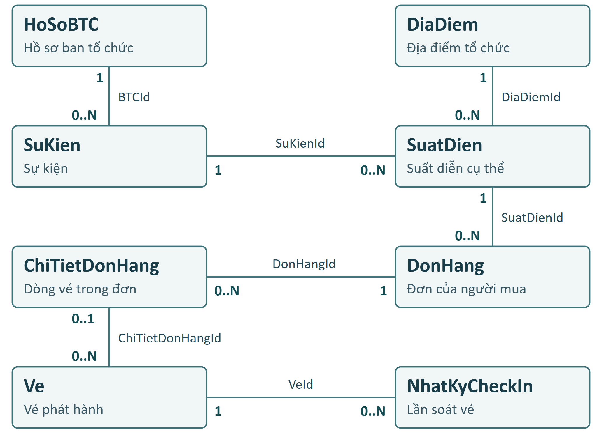
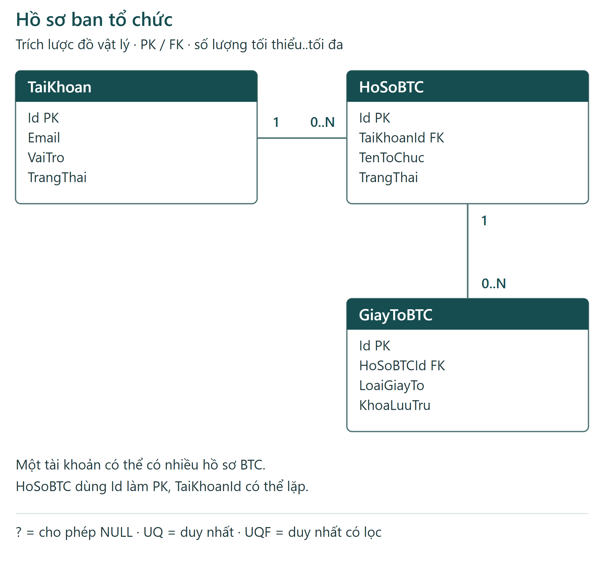
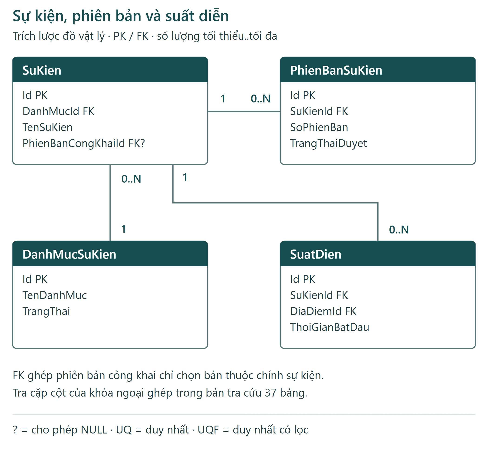
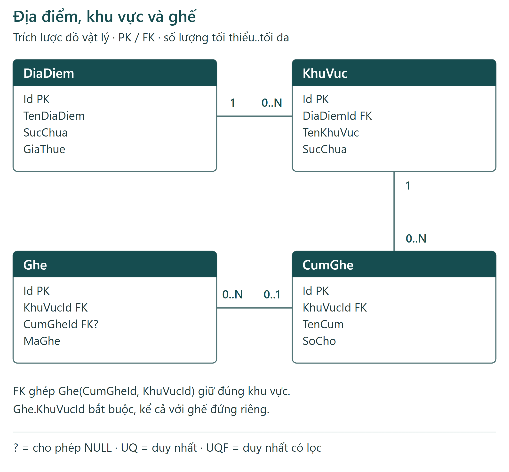
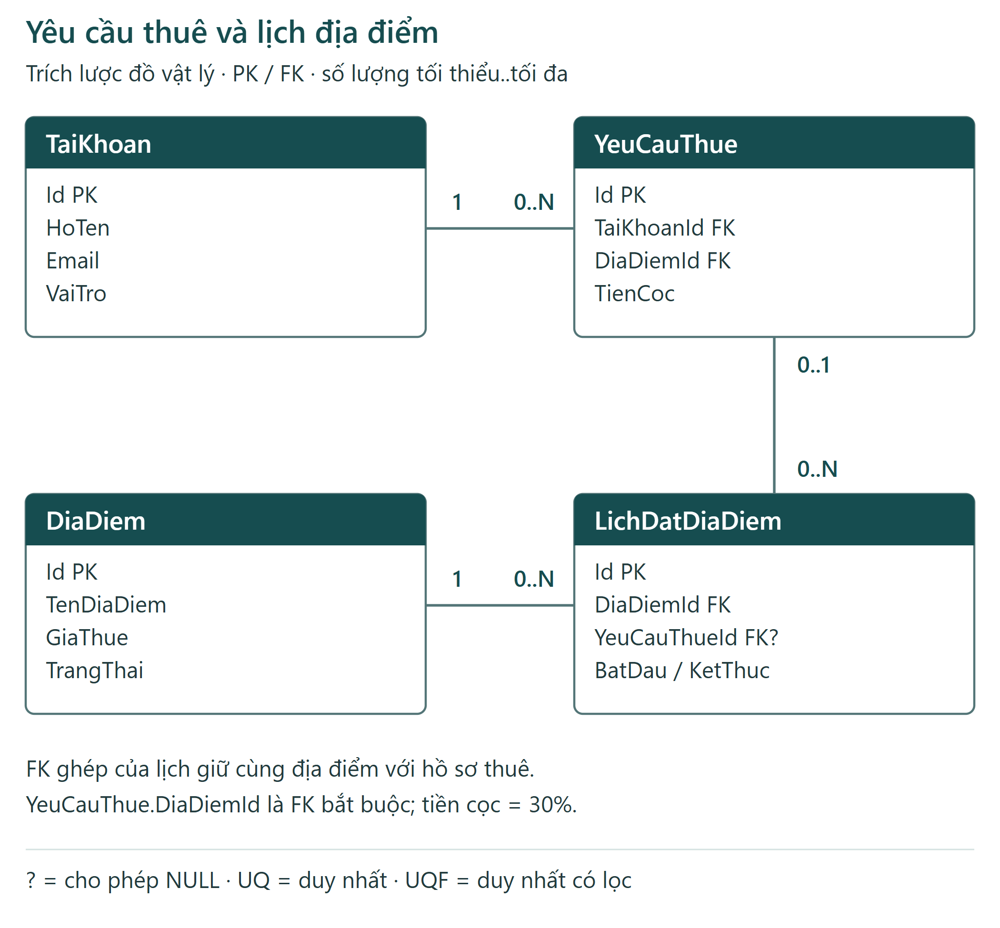
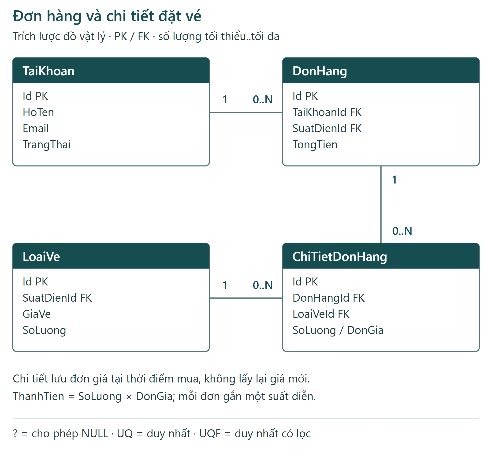
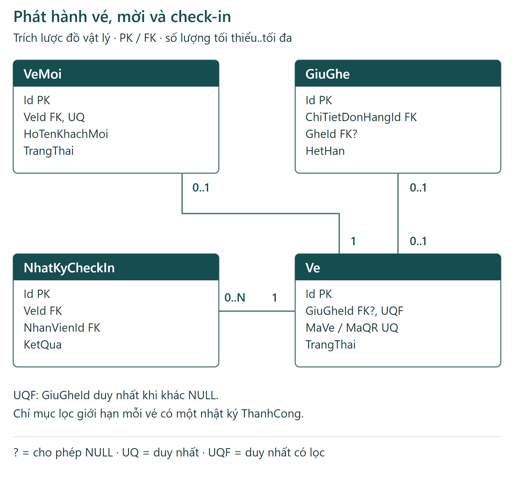
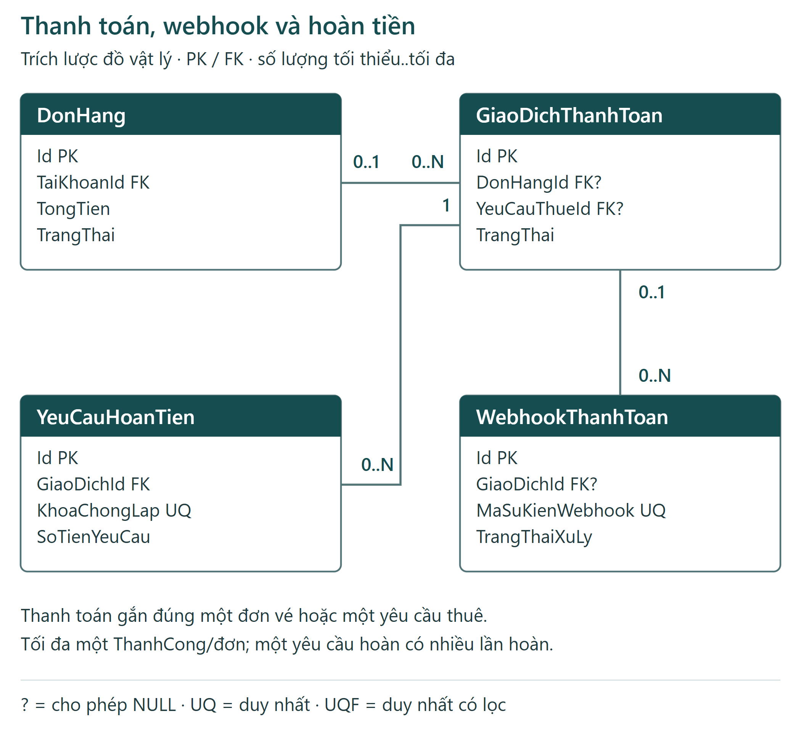
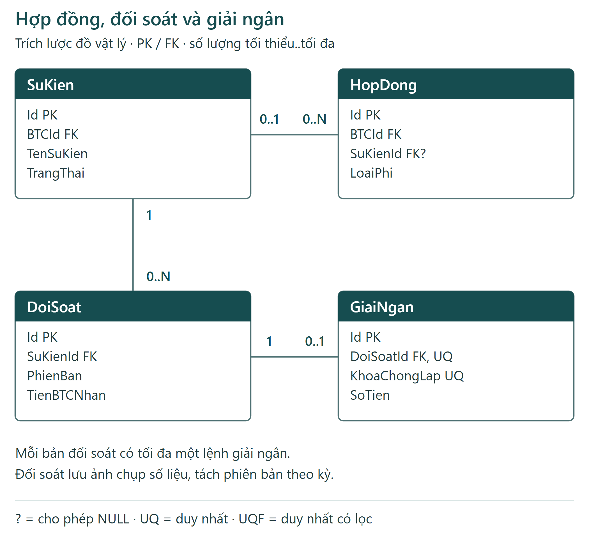

## 2.2 Thiết kế cơ sở dữ liệu

QLSK sử dụng SQL Server và Entity Framework Core. Lược đồ hiện hành có **37 bảng nghiệp vụ, 345 cột và 75 khóa ngoại**, đối chiếu từ SQL DDL với `AppDbContext` và các cấu hình ánh xạ. Mỗi bảng có PK `Id int IDENTITY`; tất cả FK dùng `NO ACTION` khi xóa nên SQL Server từ chối xóa bản ghi cha đang được tham chiếu. Không tính lịch sử migration thành bảng nghiệp vụ.

Nguồn: [AppDbContext](../../Data/AppDbContext.cs), [cấu hình EF](../../Data/Configs/), [DDL khởi tạo](../../Data/Migrations/000-initial-schema.sql), [nâng cấp tính năng](../../Data/Migrations/001-qlsk-features.sql), [danh mục ban đầu](../../Data/Migrations/002-initial-categories.sql). [Từ điển dữ liệu đầy đủ](../frontend-standardization/04_DATABASE_INVENTORY.md) trình bày từng cột, kiểu, độ dài, khả năng nhận NULL và ràng buộc.

Chuỗi tiếng Việt dùng `nvarchar`; thời điểm dùng `datetime2(3)`; ngày dùng `date`; tiền mặc định `decimal(19,0)` để lưu số nguyên đồng. Ngoại lệ là `Voucher.GiaTri decimal(19,2)` và `HopDong.TyLePhi decimal(5,2)`. Phần lớn enum được lưu thành chuỗi; `TaiKhoan.VaiTro` lưu số nguyên 1–5, mặc định 1. Không có bảng `VaiTro` riêng.

### 2.2.1 Xác định thực thể và khóa chính

**Mọi bảng dưới đây đều có PK `Id`.** Mỗi thực thể EF ánh xạ sang bảng cùng tên trong schema `dbo`. Dấu `?` chỉ cột FK nullable. Cột JSON, dữ liệu mã hóa và mã đối tượng nhật ký không tự tạo FK.

| Bảng / thực thể EF | Chức năng | FK vật lý |
|---|---|---|
| `Banner` | Nội dung quảng bá | Không có |
| `ChinhSach` | Điều khoản có phiên bản | Không có |
| `DanhMucSuKien` | Phân loại sự kiện | Không có |
| `DiaDiem` | Thông tin và giá thuê địa điểm | Không có |
| `TaiKhoan` | Đăng nhập, liên hệ, vai trò, cá nhân hóa | Không có |
| `KhuVuc` | Khu vực trong địa điểm | `DiaDiemId` → `DiaDiem(Id)` |
| `CauHinhHeThong` | Thiết lập theo khóa | `NguoiCapNhatId` → `TaiKhoan(Id)` |
| `HoSoBTC` | Hồ sơ pháp lý và xét duyệt BTC | `NguoiDuyetId?` → `TaiKhoan(Id)`<br>`TaiKhoanId` → `TaiKhoan(Id)` |
| `NhatKyHeThong` | Vết thao tác và thay đổi | `TaiKhoanId?` → `TaiKhoan(Id)` |
| `YeuCauThue` | Hồ sơ thuê, tiền cọc và phê duyệt | `ChinhSachId` → `ChinhSach(Id)`<br>`DiaDiemId` → `DiaDiem(Id)`<br>`NguoiDuyetId?` → `TaiKhoan(Id)`<br>`TaiKhoanId` → `TaiKhoan(Id)` |
| `CumGhe` | Cụm ghế đôi/ghế nhóm | `KhuVucId` → `KhuVuc(Id)` |
| `GiayToBTC` | Giấy tờ hồ sơ BTC | `HoSoBTCId` → `HoSoBTC(Id)` |
| `Ghe` | Ghế vật lý | `CumGheId?, KhuVucId` → `CumGhe(Id, KhuVucId)`<br>`KhuVucId` → `KhuVuc(Id)` |
| `ChiTietDonHang` | Loại vé, số lượng và giá từng dòng | `DonHangId` → `DonHang(Id)`<br>`LoaiVeId` → `LoaiVe(Id)` |
| `DanhGia` | Điểm sao và bình luận | `TaiKhoanId` → `TaiKhoan(Id)`<br>`SuKienId` → `SuKien(Id)` |
| `DoiSoat` | Kỳ đối soát có phiên bản | `NguoiDuyetId?` → `TaiKhoan(Id)`<br>`SuKienId` → `SuKien(Id)` |
| `GiaiNgan` | Lệnh chi của bản đối soát | `DoiSoatId` → `DoiSoat(Id)` |
| `DonHang` | Đơn mua và số tiền giao dịch | `ChinhSachId` → `ChinhSach(Id)`<br>`TaiKhoanId` → `TaiKhoan(Id)`<br>`HopDongId?` → `HopDong(Id)`<br>`SuatDienId` → `SuatDien(Id)` |
| `GiaoDichThanhToan` | Lần thanh toán vé hoặc thuê | `DonHangId?` → `DonHang(Id)`<br>`YeuCauThueId?` → `YeuCauThue(Id)` |
| `WebhookThanhToan` | Thông điệp thanh toán đã lọc | `GiaoDichId?` → `GiaoDichThanhToan(Id)` |
| `GiaoDichHoanTien` | Lần thực hiện hoàn tiền | `YeuCauHoanTienId` → `YeuCauHoanTien(Id)` |
| `GiuGhe` | Giữ chỗ có thời hạn | `ChiTietDonHangId` → `ChiTietDonHang(Id)`<br>`GheId?` → `Ghe(Id)`<br>`SuatDienId` → `SuatDien(Id)` |
| `HopDong` | Thỏa thuận phí với BTC | `BTCId` → `HoSoBTC(Id)`<br>`SuKienId?` → `SuKien(Id)` |
| `KhieuNai` | Hồ sơ hỗ trợ và xử lý | `NguoiXuLyId?` → `TaiKhoan(Id)`<br>`TaiKhoanId` → `TaiKhoan(Id)`<br>`YeuCauThueId?` → `YeuCauThue(Id)`<br>`SuKienId?` → `SuKien(Id)`<br>`VeId?` → `Ve(Id)` |
| `LichDatDiaDiem` | Khoảng giờ sử dụng địa điểm | `DiaDiemId` → `DiaDiem(Id)`<br>`YeuCauThueId?, DiaDiemId` → `YeuCauThue(Id, DiaDiemId)`<br>`SuatDienId?, DiaDiemId` → `SuatDien(Id, DiaDiemId)` |
| `LoaiVe` | Giá và hạn mức vé theo suất/khu vực | `KhuVucId` → `KhuVuc(Id)`<br>`SuatDienId` → `SuatDien(Id)` |
| `NhatKyCheckIn` | Từng lần soát vé | `NhanVienId` → `TaiKhoan(Id)`<br>`VeId` → `Ve(Id)` |
| `PhanCongSuKien` | Phân quyền nhân sự theo sự kiện/suất | `NguoiPhanCongId` → `TaiKhoan(Id)`<br>`TaiKhoanId?` → `TaiKhoan(Id)`<br>`SuKienId` → `SuKien(Id)`<br>`SuatDienId?, SuKienId` → `SuatDien(Id, SuKienId)` |
| `PhienBanSuKien` | Lịch sử nội dung và xét duyệt | `NguoiDuyetId?` → `TaiKhoan(Id)`<br>`NguoiGuiId` → `TaiKhoan(Id)`<br>`SuKienId` → `SuKien(Id)` |
| `SuKien` | Sự kiện và phiên bản công khai | `DanhMucId` → `DanhMucSuKien(Id)`<br>`BTCId` → `HoSoBTC(Id)`<br>`PhienBanCongKhaiId?, Id` → `PhienBanSuKien(Id, SuKienId)` |
| `SuatDien` | Lịch diễn, địa điểm và sơ đồ chốt | `DiaDiemId` → `DiaDiem(Id)`<br>`SuKienId` → `SuKien(Id)` |
| `Ve` | Vé phát hành, QR và trạng thái vào cổng | `ChiTietDonHangId?` → `ChiTietDonHang(Id)`<br>`GheId?` → `Ghe(Id)`<br>`GiuGheId?` → `GiuGhe(Id)`<br>`LoaiVeId, SuatDienId` → `LoaiVe(Id, SuatDienId)`<br>`SuatDienId` → `SuatDien(Id)` |
| `Voucher` | Quy tắc giảm giá | `KhuVucId?` → `KhuVuc(Id)`<br>`SuKienId?` → `SuKien(Id)`<br>`SuatDienId?` → `SuatDien(Id)` |
| `VeMoi` | Người nhận và vòng đời lời mời | `TaiKhoanNhanId?` → `TaiKhoan(Id)`<br>`VeId` → `Ve(Id)` |
| `YeuCauHoanTien` | Yêu cầu và xét duyệt hoàn | `GiaoDichId` → `GiaoDichThanhToan(Id)`<br>`NguoiDuyetId?` → `TaiKhoan(Id)`<br>`TaiKhoanId` → `TaiKhoan(Id)`<br>`VeId?` → `Ve(Id)` |
| `SuDungVoucher` | Lượt giữ/chốt voucher của đơn | `DonHangId` → `DonHang(Id)`<br>`VoucherId` → `Voucher(Id)` |
| `ThongBao` | Thông báo tới tài khoản/người mời | `TaiKhoanId?` → `TaiKhoan(Id)`<br>`VeMoiId?` → `VeMoi(Id)` |

### 2.2.2 Quan hệ và ràng buộc toàn vẹn

Quan hệ chính gồm tài khoản 1–N hồ sơ BTC; hồ sơ BTC 1–N sự kiện; sự kiện 1–N phiên bản và suất diễn; địa điểm 1–N khu vực; khu vực 1–N ghế/cụm ghế; suất diễn 1–N loại vé và đơn hàng; đơn hàng 1–N chi tiết; chi tiết 1–N lượt giữ/vé; vé 1–N nhật ký check-in. Phía cha có thể chưa có con (0–N). FK bắt buộc bảo đảm mỗi con có đúng một cha; FK nullable cho phép không tham chiếu cha. `HoSoBTC.TaiKhoanId` không duy nhất nên quan hệ tài khoản–hồ sơ không phải 1–1.

Các quan hệ đặc biệt:

- `Ve` 1–0..1 `VeMoi`, do `VeMoi.VeId` duy nhất.
- `GiuGhe` 1–0..1 `Ve` khi `GiuGheId` có giá trị, do chỉ mục duy nhất có lọc.
- `DonHang` 1–0..1 `SuDungVoucher`: một đơn không gắn nhiều bản ghi dùng voucher.
- `DoiSoat` 1–0..1 `GiaiNgan` nhờ chỉ mục duy nhất trên `DoiSoatId`.
- `GiaoDichThanhToan` tham chiếu đúng một trong `DonHang` và `YeuCauThue`, được CHECK kiểm soát. Mỗi bên vẫn có thể có nhiều lần thử thanh toán.
- `ThongBao` có đúng một đích qua tài khoản hoặc vé mời. `NhatKyHeThong.DoiTuongId` là mã tham chiếu đa hình do ứng dụng quản lý, không có FK đến mọi đối tượng.

Các FK ghép bảo vệ cả định danh lẫn phạm vi. Cặp cột đích có ràng buộc `UNIQUE` (khóa thay thế), dù `Id` đã là PK:

| FK bảng con | Cặp cột đích | Ý nghĩa |
|---|---|---|
| `Ghe(CumGheId, KhuVucId)` | `CumGhe(Id, KhuVucId)` | Ghế và cụm cùng khu vực |
| `PhanCongSuKien(SuatDienId, SuKienId)` | `SuatDien(Id, SuKienId)` | Suất phân quyền thuộc sự kiện |
| `SuKien(PhienBanCongKhaiId, Id)` | `PhienBanSuKien(Id, SuKienId)` | Phiên bản công khai thuộc chính sự kiện |
| `LichDatDiaDiem(SuatDienId, DiaDiemId)` | `SuatDien(Id, DiaDiemId)` | Lịch và suất cùng địa điểm |
| `LichDatDiaDiem(YeuCauThueId, DiaDiemId)` | `YeuCauThue(Id, DiaDiemId)` | Lịch và hồ sơ thuê cùng địa điểm |
| `Ve(LoaiVeId, SuatDienId)` | `LoaiVe(Id, SuatDienId)` | Vé và loại vé cùng suất |

**Tính duy nhất.** Tên đăng nhập duy nhất; email và số điện thoại dùng chỉ mục duy nhất có lọc `IS NOT NULL`. Mã ghế duy nhất trong khu vực; tên khu vực duy nhất trong địa điểm. Mã vé, QR, voucher, mã sự kiện webhook và các khóa chống lặp hoàn tiền/giải ngân cũng duy nhất. Phân công đang hiệu lực có hai chỉ mục riêng theo toàn sự kiện hoặc từng suất.

Các chỉ mục có lọc còn ngăn hai lượt giữ cùng ghế `DangGiu`, hai vé cùng ghế còn `DaPhatHanh`/`DaCheckIn`, hai lượt check-in thành công cho một vé và hai thanh toán thành công cho cùng đơn/yêu cầu thuê. Phạm vi duy nhất này có điều kiện, không phải cấm lưu lịch sử nhiều lần xử lý.

**CHECK.** SQL Server kiểm tra tập trạng thái, vai trò, khoảng thời gian, số tiền không âm và công thức tính. Ví dụ `ChiTietDonHang.ThanhTien = SoLuong × DonGia`; `DonHang.TongTien = TienVe − TienGiam + PhiDichVu`; tiền cọc bằng `ROUND(TongTien × 0.30, 0)`; `DoiSoat.TienBTCNhan = TongDoanhThu − TongTienHoan − PhiNenTang − TienDieuChinh`; sao đánh giá trong 1–5. Một số cột tài liệu có CHECK `ISJSON(..., OBJECT)`.

**Giới hạn.** FK và CHECK không tự giải quyết tranh chấp đồng thời, tổng hạn mức vé, chồng lấn lịch và toàn bộ chuyển trạng thái; các service phải kiểm tra nghiệp vụ và dùng giao dịch/khóa. `SuatDien.SoDoChot` có thể chứa `rentalId` nhưng SQL không có FK cho phần tử JSON này; ứng dụng kiểm tra hồ sơ thuê đúng BTC, địa điểm, trạng thái và giờ diễn. Hai FK riêng của `LoaiVe` cũng không tự bảo đảm khu vực thuộc địa điểm của suất.

### 2.2.3 Chuẩn hóa dữ liệu

Thiết kế tách các đối tượng độc lập để hạn chế lặp thông tin. Với nghiệp vụ đặt vé, nếu một đơn lưu cả thông tin khách, sự kiện, suất và danh sách nhiều loại vé thì thông tin bị lặp và phát sinh nhóm lặp. Các bảng `TaiKhoan`, `SuKien`, `SuatDien`, `LoaiVe`, `DonHang`, `ChiTietDonHang` tách dữ liệu chủ khỏi giao dịch và mỗi dòng chi tiết gắn một loại vé.

Về 1NF, phần lõi dùng các cột đơn trị và bảng chi tiết thay cho nhóm lặp. Về 2NF, PK `Id` đơn không tạo phụ thuộc bộ phận trên PK, nhưng vẫn cần xét khóa ứng viên tự nhiên thay vì chỉ dựa vào khóa thay thế. Về 3NF, tên khách phụ thuộc tài khoản, tên sự kiện phụ thuộc sự kiện và địa chỉ phụ thuộc địa điểm; các thuộc tính này nằm ở bảng chủ, tránh phụ thuộc bắc cầu trong bảng giao dịch.

**Không khẳng định toàn bộ cơ sở dữ liệu đạt 3NF nghiêm ngặt.** `ThanhTien`, `TongTien`, tiền cọc và tổng đối soát là dữ liệu dẫn xuất vẫn được lưu. Đơn giá và số tiền tại giao dịch là ảnh chụp lịch sử để không thay đổi khi bảng giá sửa. `PhienBanSuKien.NoiDung`, `SuatDien.SoDoChot`, `DoiSoat.ChiTietDoiSoat` chứa JSON; `TaiKhoan.SuKienYeuThich` và `SuKienDaXem` chứa mảng ID thay cho bảng liên kết, không có FK theo từng phần tử. Các cột phạm vi lặp trong FK ghép cũng là đánh đổi để bảo vệ tính toàn vẹn. Vì vậy mô hình lõi hướng đến 3NF, còn mô hình vật lý kết hợp chuẩn hóa với tài liệu nhúng và ảnh chụp giao dịch.

Nếu chuẩn hóa sâu hơn, có thể tách yêu thích/lịch sử xem thành bảng liên kết, tách phần JSON cần truy vấn/ràng buộc độc lập và tính các tổng bằng truy vấn. Đây là hướng cải tiến, chưa phải lược đồ đang triển khai.

### 2.2.4 ERD và ánh xạ sang bảng

Tám bảng ở hình đầu cho thấy một chỗ tham dự được truy ngược từ lượt vào cổng đến vé, dòng đơn và suất diễn. Tên cạnh đường nối là cột khóa ngoại ở bảng con. Số đặt sát một bảng cho biết một bản ghi ở đầu đối diện có thể liên kết với bao nhiêu bản ghi của bảng đó. Ví dụ, một sự kiện có từ 0 đến nhiều suất (`0..N`), còn mỗi suất thuộc đúng một sự kiện (`1`). Vé mời có thể không có dòng mua hàng nên đầu `ChiTietDonHang` ghi `0..1`.



Các hình tiếp theo đi theo từng nghiệp vụ. Mỗi ô giữ tên bảng SQL, khóa chính `Id` và các cột cần đọc cho quan hệ đang xét. Dấu `?` chỉ cột cho phép NULL. Ví dụ, để truy một giấy tờ về chủ hồ sơ, nối `GiayToBTC.HoSoBTCId` với `HoSoBTC.Id`, rồi nối `HoSoBTC.TaiKhoanId` với `TaiKhoan.Id`. Bản tra cứu kèm theo liệt kê cả 37 bảng và 75 khóa ngoại vật lý, kể cả các cặp cột của sáu khóa ngoại ghép. [Tra cứu theo tên bảng (PDF)](erd/Tra-cuu-37-bang.pdf) · [Mở từng sơ đồ dạng SVG](erd/README.md)

















`AppDbContext` khai báo 37 `DbSet` và áp dụng bảy cấu hình: `TaiKhoanConfig`, `CauHinhTaiKhoan`, `CauHinhSuKien`, `CauHinhDiaDiem`, `CauHinhDatVe`, `CauHinhTaiChinh`, `CauHinhQuanTri`. Các cấu hình dùng `ToTable`, `HasForeignKey`, `HasAlternateKey`, `HasIndex`, `HasCheckConstraint`, `HasConversion` và `OnDelete(NoAction)` để ánh xạ SQL Server.

Khởi tạo hiện dùng script SQL nhúng trong assembly, được [DatabaseSetup](../../Common/Data/DatabaseSetup.cs) chạy theo batch `GO` trong giao dịch; không phải luồng `dotnet ef database update`. Phiên bản ghi tại extended properties `QLSK.SchemaVersion = 2` và `QLSK.DemoSeedVersion = 1`, không có thêm bảng lịch sử migration. Ứng dụng gọi quy trình khi có cờ khởi tạo/nạp demo.

### 2.2.5 Cơ sở dữ liệu minh họa


Các lệnh PowerShell sau dùng cơ sở dữ liệu minh họa riêng `QLSK_BaoCao_Demo`; chạy tại thư mục gốc với .NET 10 và SQL Server LocalDB. Tên `QLSK_BaoCao_Demo` trong lệnh là tên gợi ý để tái lập; lần kiểm chứng thực tế bên dưới dùng một tên ngẫu nhiên riêng.

```powershell
$env:ASPNETCORE_ENVIRONMENT = 'Development'
$env:ConnectionStrings__QLSK = 'Server=(localdb)\MSSQLLocalDB;Database=QLSK_BaoCao_Demo;Integrated Security=true;TrustServerCertificate=true'
dotnet run --no-launch-profile -- --qlsk-init
dotnet run --no-launch-profile -- --qlsk-seed-demo
```

Sau khi nạp, chạy `dotnet run --no-launch-profile --urls http://localhost:5078`, rồi mở `http://localhost:5078` để xem giao diện và đăng nhập bằng tài khoản demo. Giữ cùng các biến môi trường ở cửa sổ PowerShell đó để ứng dụng dùng đúng cơ sở dữ liệu minh họa.

Seed cũng gọi khởi tạo trước khi nạp. Nếu không cấu hình `QLSK__Demo__Password`, mật khẩu được sinh ngẫu nhiên và in một lần ra console; cần lưu để đăng nhập. Không đưa mật khẩu thật vào báo cáo. Bộ demo có các tài khoản `admin`, `manager`, `organizer`, `other-organizer`, `staff`, `customer`, `pending-organizer` với email `@qlsk.test` và tên đăng nhập có tiền tố `demo-`.

[DemoSeed](../../Data/seed/DemoSeed.cs) chạy trong giao dịch có khóa `qlsk:demo-seed`; bỏ qua nếu dấu phiên bản đã là 1, báo lỗi nếu tài khoản trùng khi chưa seed. Trình tự nạp là tài khoản → chính sách/cấu hình → danh mục/sự kiện/địa điểm → thuê → vé/tài chính → trang chủ/cá nhân hóa → giấy tờ mẫu. Các script ở [Data/seed](../../Data/seed/). `ProtectRentals` mã hóa nội dung thuê bằng ASP.NET Data Protection; `NoiDungYeuCau` không phải JSON bản rõ để đọc trực tiếp bằng SQL.

**Kết quả thực nghiệm mới lúc 18:49:12 ngày 21/11/2026 (UTC+7):** đã chạy `dotnet QLSK.dll --qlsk-seed-demo` trên LocalDB cô lập `QLSK_REPORT_7a4f2697469c`, thu được **37/37 bảng có dữ liệu, tổng 694 dòng**, 7 tài khoản, `QLSK.SchemaVersion = 2` và `QLSK.DemoSeedVersion = 1`. Chạy lại seed giữ nguyên số dòng của cả 37 bảng; số tệp tài liệu mẫu riêng vẫn là 1. Cơ sở dữ liệu thử đã được xóa sau kiểm chứng, dữ liệu QA không bị thay đổi. [Bằng chứng đếm từng bảng và hai lần chạy](bang-chung/isolated-demo-seed.json).

Bảng dưới tổng hợp số liệu lần kiểm chứng mới; các số cũng phù hợp [báo cáo SQL đã lưu](../bc_01_sql.md):

| Nhóm | Số lượng đã ghi nhận |
|---|---|
| Tài khoản và BTC | 7 tài khoản; 5 hồ sơ; 5 giấy tờ |
| Sự kiện | 6 danh mục; 14 sự kiện; 17 phiên bản; 14 suất |
| Địa điểm và vé | 5 địa điểm; 256 ghế; 38 loại vé; 21 đơn; 37 vé |
| Vận hành | 5 lời mời; 7 voucher; 11 phân công; 14 nhật ký check-in |
| Thuê | 10 yêu cầu thuê; 14 lịch địa điểm |
| Tài chính | 25 giao dịch thanh toán; 10 yêu cầu hoàn; 6 giao dịch hoàn; 14 hợp đồng; 6 đối soát; 2 giải ngân |
| Nội dung và quản trị | 4 banner; 6 thông báo; 4 chính sách; 4 cấu hình; 46 nhật ký hệ thống |

Dữ liệu bao phủ sự kiện đang bán, đã kết thúc, hoãn, hủy; yêu cầu thuê chờ duyệt, chờ cọc, xác nhận, hết hạn. Các giao dịch tài chính là mô phỏng. [Bằng chứng kiểm thử](../testcases/evidence/seed-demo/kiem-thu.json) ghi nhận 244/244 phép kiểm tra API theo vai trò; kết quả không thay thế kiểm thử PayOS thật.

Có thể kiểm tra cơ sở dữ liệu minh họa bằng SQL sau trong SSMS hoặc `sqlcmd`. Câu đếm dùng `COUNT_BIG(*)` cho từng bảng:

```sql
SELECT COUNT(*) AS SoBangNghiepVu FROM sys.tables WHERE is_ms_shipped = 0;
SELECT COUNT(*) AS SoKhoaNgoai FROM sys.foreign_keys;
SELECT name, value FROM sys.extended_properties
WHERE class = 0 AND name IN (N'QLSK.SchemaVersion', N'QLSK.DemoSeedVersion');
DECLARE @DemDong nvarchar(max);
SELECT @DemDong = STRING_AGG(CONVERT(nvarchar(max),
    N'SELECT N''' + REPLACE(s.name + N'.' + t.name, N'''', N'''''') +
    N''' AS TenBang, COUNT_BIG(*) AS SoDong FROM ' +
    QUOTENAME(s.name) + N'.' + QUOTENAME(t.name)), N' UNION ALL ')
FROM sys.tables AS t JOIN sys.schemas AS s ON s.schema_id = t.schema_id
WHERE t.is_ms_shipped = 0;
EXEC sys.sp_executesql @DemDong;
```

[Kịch bản kiểm thử ràng buộc](../../test/RangBuoc.sql) bao gồm tài khoản, phiên bản công khai, phân công, giữ ghế, cấp vé, check-in và webhook; dữ liệu thử được hoàn tác cuối giao dịch. Khi nâng cấp cần đối chiếu cả EF model, SQL DDL và dữ liệu thực tế; dấu phiên bản không tự chứng minh mọi cột và ràng buộc vẫn khớp.


