## 2.3 Thiết kế hệ thống

### 2.3.1 Phạm vi và căn cứ thiết kế

Thiết kế dưới đây mô tả hệ thống hiện có trong mã nguồn QLSK: ASP.NET Core Web API, Entity Framework Core với SQL Server và giao diện SPA JavaScript. Đây là ánh xạ trách nhiệm MVC: Model bao gồm thực thể và dịch vụ nghiệp vụ; View chạy trong trình duyệt; Controller cung cấp API JSON. Hệ thống không sử dụng Razor View để kết xuất giao diện.

Căn cứ: [cấu hình dự án](../../QLSK.csproj), [khởi tạo ứng dụng](../../Program.cs), [khả năng được phép theo phiên](../../Features/Capabilities/CapabilityService.cs), [kiểm tra quyền](../../Common/Security/SessionCookie.cs), [API phía trình duyệt](../../wwwroot/app/api.js). Các nguồn PlantUML chỉnh sửa được nằm cạnh từng ảnh trong thư mục [uml](uml/); nội dung tiếng Việt được lưu UTF-8. Sơ đồ là góc nhìn nghiệp vụ có chọn lọc, không khẳng định mọi nhánh kỹ thuật đều được thể hiện.

### 2.3.2 Biểu đồ use case tổng quan

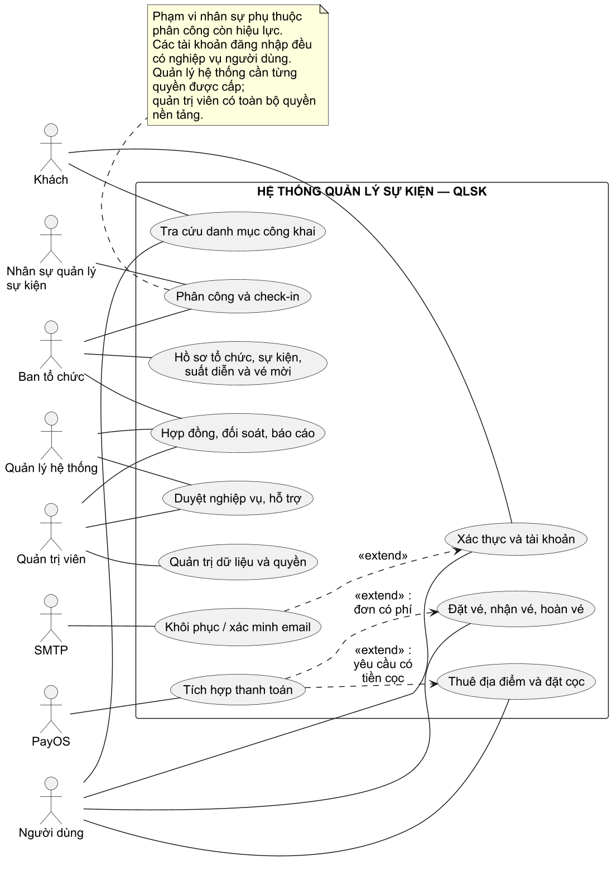

Hình 2.3.1 phân biệt tám tác nhân: khách, năm vai trò tài khoản, PayOS và SMTP. Khách không có phiên đăng nhập. PayOS và SMTP là hệ thống ngoài ranh giới QLSK. Người mua và người nhận vé mời đều thuộc tác nhân Người dùng; người yêu cầu thuê không phải một vai trò tài khoản độc lập. Không tạo thêm vai trò kế toán hoặc nhân viên soát vé ngoài enum thực tế.

Tất cả tài khoản đăng nhập có các nghiệp vụ cá nhân trong phạm vi dữ liệu của mình. Ban tổ chức cần hồ sơ đã duyệt và quyền sở hữu đối với sự kiện. Nhân sự quản lý sự kiện chỉ thao tác trong phân công còn hiệu lực, theo sự kiện hoặc suất. Quản lý hệ thống cần từng quyền trong QuyenQuanLy; quản trị viên vượt qua kiểm tra quyền nền tảng nhưng không mặc nhiên sở hữu sự kiện và không mặc nhiên có quyền check-in. Quyền được quảng bá bởi capabilities còn phụ thuộc cấu hình PayOS và email; dịch vụ vẫn kiểm tra quyền khi thực thi.

| Tác nhân | Mã vai trò / điều kiện | Phạm vi chính |
|---|---|---|
| Khách | Chưa đăng nhập | Tra cứu công khai, đăng ký, đăng nhập |
| Người dùng | NguoiDung = 1 | Vé, đơn hàng, thuê địa điểm, yêu cầu cá nhân |
| Ban tổ chức | BanToChuc = 2; hồ sơ được duyệt | Sự kiện của tổ chức, vé mời, phân công, đối soát |
| Nhân sự quản lý sự kiện | QuanLySuKien = 3 | checkin.scan, checkin.manual, attendees.view theo phân công |
| Quản lý hệ thống | QuanLyHeThong = 4 | Duyệt hồ sơ, sự kiện, thuê, hỗ trợ, hoàn tiền, tài chính theo quyền |
| Quản trị viên | QuanTriVien = 5 | Tài khoản, danh mục, địa điểm, cấu hình, hợp đồng và quyền nền tảng |
| PayOS | Cấu hình thanh toán hợp lệ | Liên kết, truy vấn trạng thái, webhook |
| SMTP | Cấu hình thư hợp lệ | Gửi mã khôi phục và xác minh email |

### 2.3.3 Use case chi tiết theo tác nhân

Trong các bảng mô tả, tiền điều kiện chung của nghiệp vụ có bảo vệ là phiên còn hiệu lực, tài khoản được phép thao tác và mã CSRF hợp lệ cho lệnh ghi qua giao diện. Hậu điều kiện thành công là dữ liệu được lưu theo giao dịch nghiệp vụ; nếu bị từ chối thì không coi như thành công. Các use case con cùng một chu trình được nhóm để giữ biểu đồ dễ đọc.

#### a. Khách chưa đăng nhập

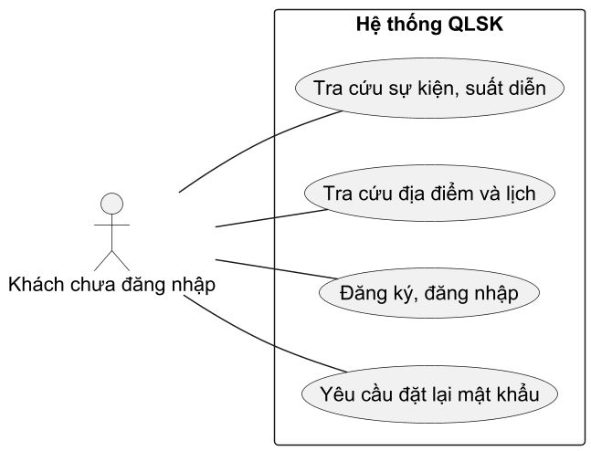

| Mã / mục tiêu | Tiền điều kiện | Luồng chính | Ngoại lệ và hậu điều kiện |
|---|---|---|---|
| UC-K01 Tra cứu | Danh mục được công khai | 1. Chọn bộ lọc. 2. Xem danh sách. 3. Mở sự kiện, suất hoặc địa điểm và lịch. | Không có bản ghi thì hiển thị kết quả phù hợp; lỗi API không được giả làm danh sách rỗng. Không làm thay đổi dữ liệu nghiệp vụ. |
| UC-K02 Đăng ký | Có ít nhất email hoặc số điện thoại; tên đăng nhập và liên hệ chưa trùng | 1. Nhập thông tin. 2. Kiểm tra định dạng và trùng lặp. 3. Tạo tài khoản theo chính sách đăng ký. | Tên đăng nhập/liên hệ trùng hoặc dữ liệu sai: trả lỗi, không tạo bản ghi trùng. |
| UC-K03 Đăng nhập | Tài khoản hoạt động | 1. Nhập email hoặc số điện thoại và mật khẩu. 2. Xác thực. 3. Cấp cookie phiên. 4. Đọc capabilities. | Sai mật khẩu, tài khoản khóa hoặc giới hạn tần suất: không cấp phiên. |
| UC-K04 Khôi phục mật khẩu | Có cấu hình thư | 1. Gửi yêu cầu. 2. Nhận mã qua email. 3. Gửi mã và mật khẩu mới. 4. Xác nhận thay đổi. | Mã sai/hết hạn hoặc thư chưa cấu hình: không đổi mật khẩu. |

Căn cứ: [AccountController](../../Features/Accounts/AccountController.cs), [AccountService](../../Features/Accounts/AccountService.cs), [CatalogService](../../Features/Catalog/CatalogService.cs).

#### b. Người dùng

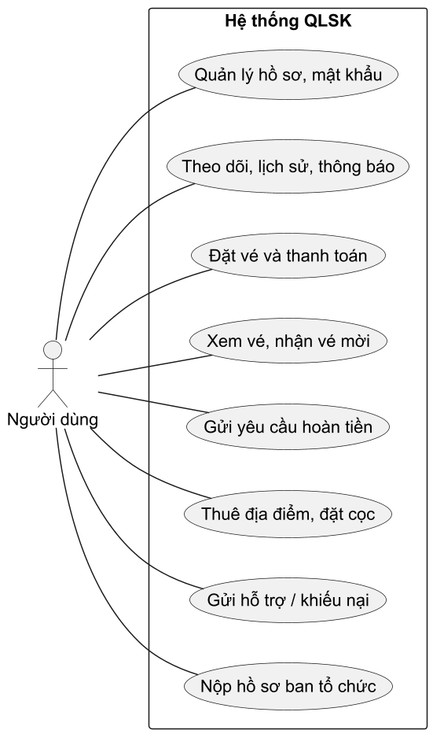

| Mã / mục tiêu | Tiền điều kiện | Luồng chính | Ngoại lệ và hậu điều kiện |
|---|---|---|---|
| UC-U01 Hồ sơ và tương tác cá nhân | Đăng nhập | 1. Mở tài khoản. 2. Sửa hồ sơ/đổi mật khẩu hoặc xem theo dõi, lịch sử, thông báo. 3. Gửi và kiểm tra kết quả. | Dữ liệu sai hoặc phiên cũ: từ chối; thay đổi mật khẩu cập nhật phiên theo cơ chế tài khoản. |
| UC-U02 Đặt vé | Suất mở bán; chính sách hiện hành | 1. Chọn từ 1 đến 10 ghế và trọn cụm ghế. 2. Gửi khóa idempotency. 3. Kiểm tra giá, voucher, sức chứa. 4. Tạo đơn và giữ ghế. | Ghế bị giữ/bán, vượt 10 vé gồm vé đã mua và đang giữ, chính sách đổi: báo xung đột. Gửi lại cùng khóa và cùng nội dung trả về đơn cũ. |
| UC-U03 Thanh toán và nhận vé | Chủ đơn; đơn có phí còn hạn; PayOS sẵn sàng | 1. Mở liên kết thanh toán. 2. Thanh toán tại PayOS. 3. QLSK xác minh webhook hoặc đối soát. 4. Chốt ghế và phát hành vé. | Không lấy trang chuyển hướng làm chứng cứ đã thu. Thu sai/thu muộn/hết ghế được phân loại cần xử lý; không phát hành sai. Đơn miễn phí được xử lý theo nhánh riêng. |
| UC-U04 Vé và vé mời | Sở hữu vé hoặc có mã nhận vé mời hợp lệ | 1. Xem vé/QR/PDF. 2. Với vé mời, phân giải liên kết và xác nhận nhận. 3. Theo dõi trạng thái vé. | Mã hết hạn, bị thu hồi, sai người nhận hoặc không thuộc tài khoản: từ chối. |
| UC-U05 Yêu cầu hoàn tiền | Vé đã phát hành; sự kiện cho tự hủy; cách suất ít nhất 72 giờ; có khoản thực thu | 1. Chọn vé thuộc giao dịch của mình. 2. Nhập lý do. 3. Kiểm tra phần tiền được hoàn. 4. Tạo yêu cầu chờ duyệt. | Vé đã check-in, trùng yêu cầu, vượt tiền thực thu hoặc không đủ điều kiện: từ chối. Tạo/duyệt yêu cầu không đồng nghĩa tiền đã được chuyển. |
| UC-U06 Thuê và đặt cọc | Địa điểm và khoảng thời gian hợp lệ | 1. Gửi nội dung thuê. 2. Theo dõi duyệt. 3. Nếu cọc bằng 0 thì xác nhận ngay; nếu cọc lớn hơn 0 thì chuyển Chờ cọc. 4. Xác minh thanh toán trong hạn 24 giờ và xác nhận lịch. | Trùng lịch hoặc quá hạn cọc: không xác nhận trái điều kiện. Có thể hủy khi trạng thái và khoản thanh toán cho phép. |
| UC-U07 Hỗ trợ / khiếu nại | Đăng nhập; đối tượng liên quan thuộc phạm vi cho phép | 1. Chọn nội dung. 2. Gửi yêu cầu. 3. Xem tiến độ và kết quả giải quyết. | Dữ liệu thiếu hoặc đối tượng không thuộc phạm vi: từ chối. |
| UC-U08 Nộp hồ sơ tổ chức | Vai trò người dùng hoặc ban tổ chức | 1. Nhập hồ sơ và giấy tờ. 2. Nộp. 3. Theo dõi duyệt hoặc bổ sung. | Thiếu dữ liệu hoặc trạng thái không cho phép nộp: báo lỗi. Hồ sơ nộp chưa tự có quyền sở hữu sự kiện được duyệt. |

Căn cứ: [OrderService](../../Features/Tickets/OrderService.cs), [xử lý thanh toán đơn](../../Features/Tickets/OrderPayments.cs), [vé](../../Features/Tickets/TicketService.cs), [vé mời](../../Features/Admissions/Invitations.cs), [yêu cầu](../../Features/Requests/RequestService.cs), [hoàn tiền](../../Features/Requests/RefundService.cs).

#### c. Ban tổ chức

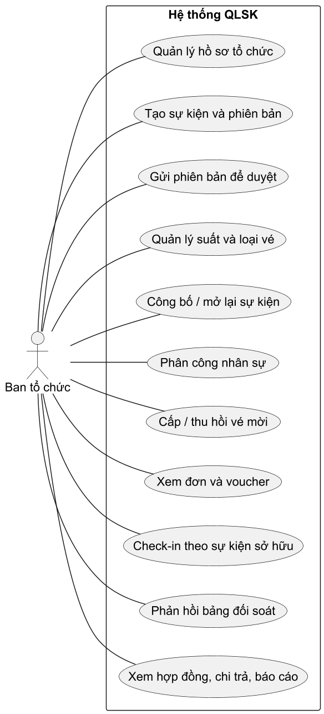

| Mã / mục tiêu | Tiền điều kiện | Luồng chính | Ngoại lệ và hậu điều kiện |
|---|---|---|---|
| UC-B01 Tạo và gửi phiên bản | Hồ sơ tổ chức đã duyệt; sở hữu sự kiện khi sửa | 1. Tạo sự kiện/phiên bản. 2. Khai báo suất, địa điểm, loại vé. 3. Kiểm tra. 4. Gửi duyệt. | Thiếu dữ liệu, lịch/sơ đồ không hợp lệ hoặc trạng thái sai: giữ việc sửa ở luồng nháp, không coi là đã công bố. |
| UC-B02 Công bố / thay đổi sự kiện | Phiên bản đủ điều kiện theo loại yêu cầu | 1. Xem kết quả duyệt. 2. Công bố tạo mới hoặc gửi phiên bản cập nhật/hoãn/hủy. 3. Áp dụng theo quyết định hợp lệ. | Phân biệt duyệt với công bố; sự kiện được duyệt riêng tư chưa tự xuất hiện công khai. Thay đổi phải theo phiên bản và trạng thái thực tế. |
| UC-B03 Phân công nhân sự | Sở hữu sự kiện; tài khoản đích phù hợp | 1. Chọn người và phạm vi sự kiện/suất. 2. Chọn quyền. 3. Cấp phân công. 4. Thu hồi khi cần. | Quyền chưa hỗ trợ, sai phạm vi hoặc tài khoản không phù hợp: không cấp. Quyền chỉ có hiệu lực khi phân công đang hiệu lực. |
| UC-B04 Quản lý vé mời | Sở hữu sự kiện; loại vé và sức chứa hợp lệ | 1. Chọn suất/khách/ghế phù hợp. 2. Cấp vé mời. 3. Tạo liên kết nhận hoặc PDF. 4. Thu hồi khi được phép. | Hết chỗ, ghế xung đột, vé sai trạng thái: từ chối. |
| UC-B05 Theo dõi vận hành | Sự kiện thuộc tổ chức | 1. Xem đơn, voucher và số liệu. 2. Xem người tham dự. 3. Check-in khi điều kiện suất cho phép. 4. Xuất báo cáo thuộc phạm vi. | Không truy cập sự kiện tổ chức khác; kiểm tra quyền tại dịch vụ. |
| UC-B06 Phản hồi đối soát | Bảng đối soát thuộc tổ chức và còn cho phản hồi | 1. Xem khoản thu, hoàn và phí. 2. Xác nhận hoặc tranh chấp. 3. Theo dõi duyệt, hợp đồng và khoản chi trả. | Hết hạn hoặc sai trạng thái: áp dụng điều kiện dịch vụ; việc xem bảng không chứng minh đã giải ngân. |

Căn cứ: [EventService](../../Features/Events/EventService.cs), [StaffGrantService](../../Features/Admissions/StaffGrantService.cs), [AdmissionService](../../Features/Admissions/AdmissionService.cs), [FinanceService](../../Features/Finance/FinanceService.cs).

#### d. Nhân sự quản lý sự kiện

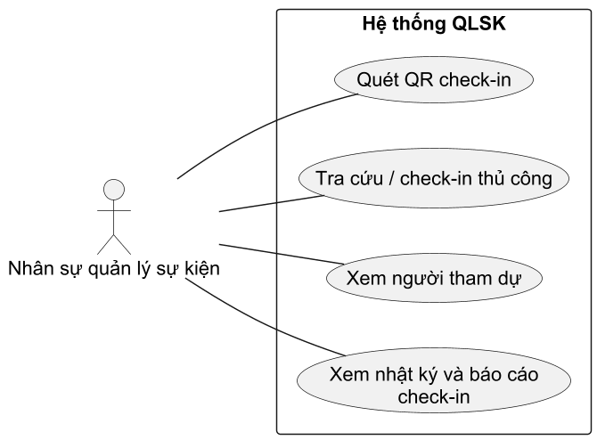

| Mã / mục tiêu | Tiền điều kiện | Luồng chính | Ngoại lệ và hậu điều kiện |
|---|---|---|---|
| UC-S01 Quét QR | Có checkin.scan còn hiệu lực trong phạm vi suất | 1. Chọn suất. 2. Quét mã. 3. Kiểm tra trạng thái sự kiện/suất và vé. 4. Ghi check-in. | Sai suất, vé hủy/thu hồi, đã check-in hoặc suất kết thúc: báo kết quả tương ứng; không ghi thành công lần hai. |
| UC-S02 Check-in thủ công | Có checkin.manual | 1. Tra mã vé/đơn/email/điện thoại. 2. Chọn đúng vé. 3. Xác nhận. 4. Ghi hình thức ThuCong. | Tra cứu không thấy hoặc thiếu quyền: không thực hiện; quyền QR không thay thế quyền thủ công. |
| UC-S03 Tra cứu và báo cáo | Có attendees.view và loại báo cáo được capabilities cấp | 1. Xem người tham dự hoặc nhật ký. 2. Xem chi tiết. 3. Lọc/xuất báo cáo được phép. | Không có quyền xem thì không cung cấp dữ liệu; không suy ra có quyền xem chỉ từ quyền quét. |

Căn cứ: [AdmissionService](../../Features/Admissions/AdmissionService.cs), [ReportService](../../Features/Reports/ReportService.cs).

#### e. Quản lý hệ thống

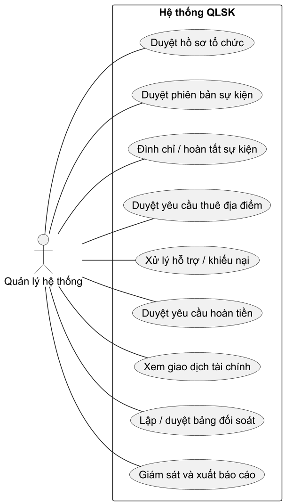

| Mã / mục tiêu | Tiền điều kiện | Luồng chính | Ngoại lệ và hậu điều kiện |
|---|---|---|---|
| UC-M01 Duyệt tổ chức/sự kiện | Có quyền duyệt tương ứng; đối tượng chờ duyệt | 1. Mở hàng đợi. 2. Đọc hồ sơ/phiên bản. 3. Chấp thuận, yêu cầu bổ sung hoặc từ chối theo thao tác hỗ trợ. 4. Lưu quyết định và lịch sử. | Thiếu quyền, tự duyệt khi bị cấm hoặc phiên bản đã đổi: từ chối; không quyết định trên dữ liệu cũ. |
| UC-M02 Duyệt thuê / hỗ trợ | rentals.review hoặc support.review | 1. Mở yêu cầu. 2. Kiểm tra lịch hoặc nội dung. 3. Ghi quyết định và lý do. 4. Người gửi xem kết quả. | Trùng lịch, yêu cầu không còn xử lý được hoặc quyền thiếu: từ chối thao tác. |
| UC-M03 Duyệt hoàn tiền | refunds.review | 1. Xem yêu cầu và khoản thu. 2. Kiểm tra giới hạn và trạng thái. 3. Nhập quyết định, lý do. 4. Lưu kết quả. | Không tự coi quyết định duyệt là giao dịch ngân hàng thành công; trạng thái chuyển tiền là thông tin riêng. |
| UC-M04 Tài chính | finance.review | 1. Xem khoản thu. 2. Chọn sự kiện hoàn tất, kỳ đã đóng. 3. Lập bảng đối soát. 4. Nhận phản hồi và duyệt theo điều kiện. | Kỳ chồng lấn, còn khiếu nại/hoàn chưa xử lý, chứng cứ thu không khớp hoặc chưa hết thời gian khóa sổ: không lập bảng. |
| UC-M05 Giám sát và báo cáo | Quyền giám sát hoặc loại báo cáo phù hợp | 1. Chọn phạm vi. 2. Xem tổng quan/giám sát. 3. Xem trước. 4. Xuất hoặc in báo cáo. | Không có loại báo cáo được cấp: không hiển thị/xuất ngoài phạm vi. |

Căn cứ: [OperationsService](../../Features/Operations/OperationsService.cs), [OrganizerService](../../Features/Organizers/OrganizerService.cs), [lập đối soát](../../Features/Finance/FinanceSettlements.cs).

#### f. Quản trị viên

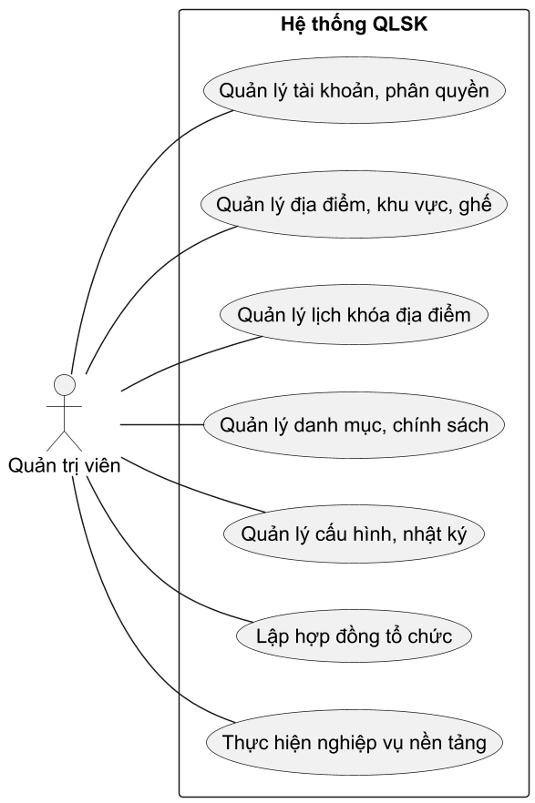

| Mã / mục tiêu | Tiền điều kiện | Luồng chính | Ngoại lệ và hậu điều kiện |
|---|---|---|---|
| UC-A01 Tài khoản và quyền | Vai trò QuanTriVien | 1. Tra cứu tài khoản. 2. Chọn cập nhật trạng thái hoặc vai trò/quyền. 3. Kiểm tra ràng buộc. 4. Lưu và kiểm tra phiên theo cơ chế hệ thống. | Trạng thái/đầu vào không hợp lệ hoặc vi phạm bảo vệ quản trị: không cập nhật. |
| UC-A02 Dữ liệu nền | Vai trò QuanTriVien | 1. Chọn địa điểm/khu vực/ghế/danh mục/chính sách. 2. Nhập thông tin. 3. Kiểm tra tham chiếu và lịch. 4. Lưu. | Không bỏ qua ràng buộc ghế, sức chứa hoặc lịch chỉ vì có vai trò quản trị. |
| UC-A03 Cấu hình và nhật ký | Vai trò QuanTriVien | 1. Xem cấu hình/nhật ký. 2. Cập nhật giá trị được hỗ trợ. 3. Theo dõi giám sát. | Giá trị ngoài giới hạn: từ chối; nhật ký phản ánh thao tác được triển khai. |
| UC-A04 Hợp đồng và duyệt nền tảng | Vai trò QuanTriVien; đối tượng hợp lệ | 1. Tạo hợp đồng tổ chức. 2. Xem tài chính hoặc hàng đợi. 3. Thực hiện nghiệp vụ theo quy trình quản lý tương ứng. | Quyền nền tảng không thay thế kiểm tra trạng thái, sở hữu hoặc phân công check-in. |

Căn cứ: [CatalogAdminService](../../Features/Catalog/CatalogAdminService.cs), [OperationsService](../../Features/Operations/OperationsService.cs), [FinanceService](../../Features/Finance/FinanceService.cs).

#### g. Cổng thanh toán PayOS

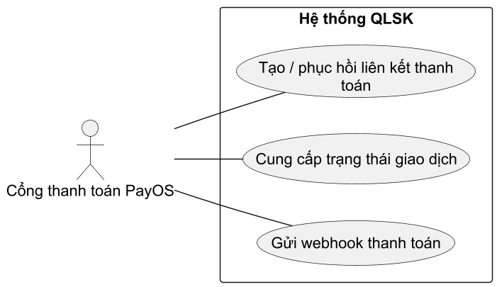

| Mã / mục tiêu | Tiền điều kiện | Luồng chính | Ngoại lệ và hậu điều kiện |
|---|---|---|---|
| UC-P01 Liên kết thanh toán | Cấu hình PayOS; ý định thanh toán hợp lệ đã lưu | 1. QLSK tạo mã đối tác xác định. 2. Tra liên kết sẵn có. 3. Nếu chưa có thì tạo. 4. Trả URL cho chủ đơn/yêu cầu thuê. | Timeout có thể thử lại bằng mã xác định; không tạo khoản thu đã xác nhận chỉ vì tạo được URL. |
| UC-P02 Xác minh giao dịch | Webhook hoặc yêu cầu đối soát hợp lệ | 1. Nhận webhook và kiểm chữ ký hoặc gọi truy vấn trạng thái. 2. Đối chiếu mã, số tiền, trạng thái. 3. Áp dụng trong giao dịch nghiệp vụ. | Chữ ký sai, số tiền sai, thông báo lặp hoặc thu muộn: xử lý theo nhánh bảo vệ; không phát hành vé trùng. |

Căn cứ: [RentalPayOs](../../Features/Requests/RentalPayOs.cs), [OrderPayments](../../Features/Tickets/OrderPayments.cs), [OrderWebhookController](../../Features/Tickets/OrderWebhookController.cs), [RentalWebhookController](../../Features/Requests/RentalWebhookController.cs).

#### h. Máy chủ thư SMTP

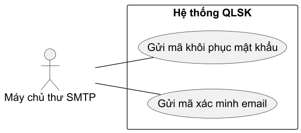

| Mã / mục tiêu | Tiền điều kiện | Luồng chính | Ngoại lệ và hậu điều kiện |
|---|---|---|---|
| UC-E01 Gửi mã xác thực | Dịch vụ thư được cấu hình; yêu cầu theo chính sách tài khoản | 1. QLSK tạo mã/giới hạn hiệu lực. 2. Gửi thư qua SMTP. 3. Người dùng gửi mã lại API. 4. QLSK xác minh mã trước khi thay đổi tài khoản. | Gửi thư lỗi không chứng minh người dùng đã nhận; mã hết hạn/sai không được chấp nhận. SMTP chỉ chuyển thư, không tự cấp quyền tài khoản. |

Căn cứ: [AccountService](../../Features/Accounts/AccountService.cs). Không mô hình hóa SMS hay ngân hàng giải ngân thành tác nhân tích hợp đã hoàn thiện chỉ vì có enum/bảng liên quan.

### 2.3.4 Biểu đồ hoạt động

#### a. Đăng nhập

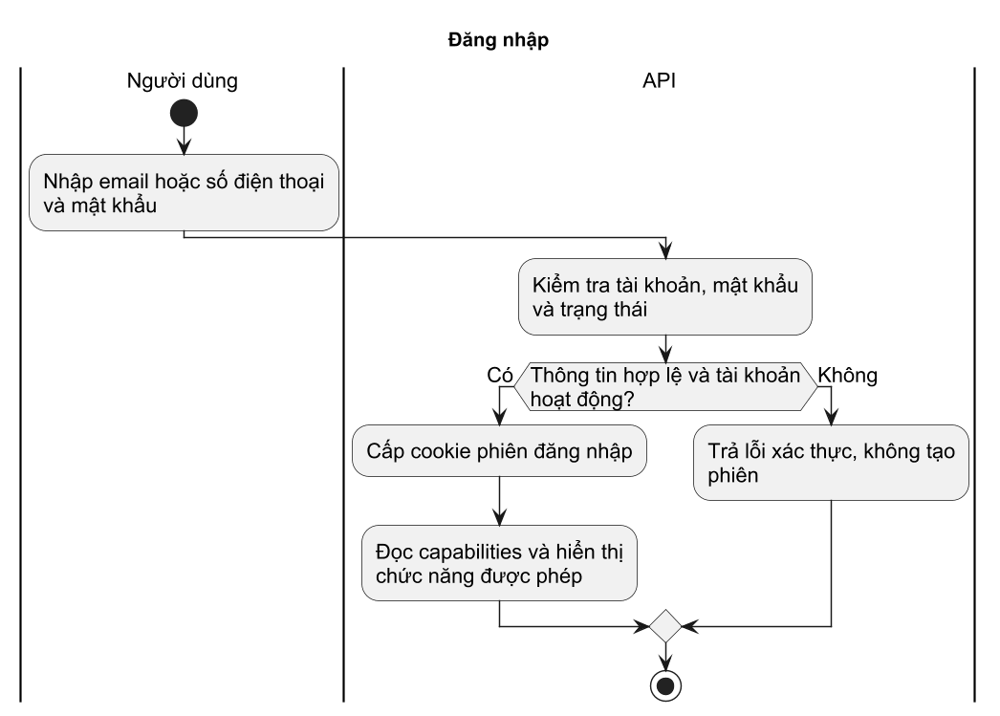

Luồng: người dùng gửi thông tin; API kiểm tra mật khẩu và trạng thái. Thành công thì cấp cookie và tải capabilities để giao diện hiển thị đúng thao tác. Thất bại thì trả lỗi và không cấp phiên. Cookie xác thực vẫn phải được kiểm tra trên các yêu cầu sau.

#### b. Đặt vé và giữ ghế

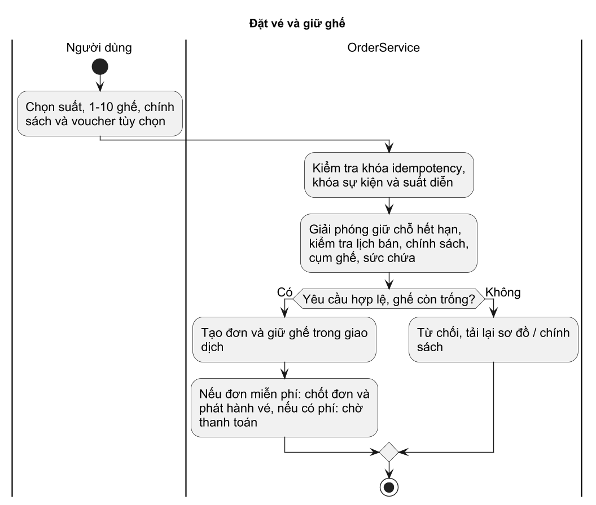

Luồng: chọn suất và ghế, gửi chính sách và khóa idempotency; dịch vụ khóa các tài nguyên liên quan trong giao dịch, giải phóng giữ chỗ hết hạn và kiểm tra lịch bán, cụm ghế, sức chứa, voucher và giới hạn mua. Hợp lệ thì tạo đơn và giữ chỗ; miễn phí có nhánh chốt và phát hành, đơn có phí chờ thanh toán. Xung đột trả lỗi để tải lại. Khóa gửi lại chỉ tái sử dụng đơn khi nội dung khớp.

#### c. Thanh toán đơn vé

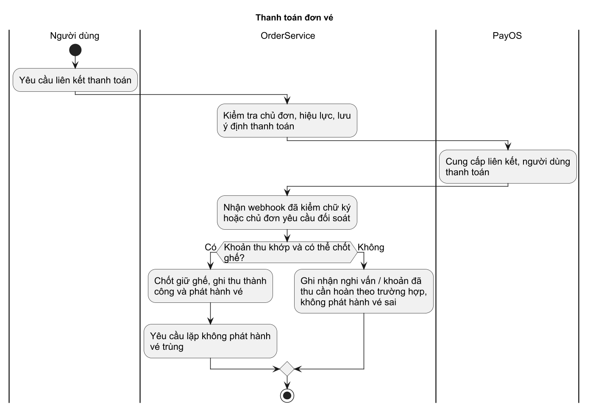

Luồng: chủ đơn xin liên kết; QLSK lưu ý định thanh toán trước khi gọi PayOS và phục hồi liên kết khi thử lại. Sau thanh toán, webhook đã kiểm chữ ký hoặc truy vấn đối soát cung cấp chứng cứ cho dịch vụ. Khoản thu phù hợp và ghế còn chốt được mới phát hành vé. Trường hợp thu muộn, hết chỗ hoặc nghi vấn được phân loại để xử lý; một lần gọi từ trình duyệt không đủ chứng minh đã thanh toán.

#### d. Tạo, duyệt và công bố sự kiện

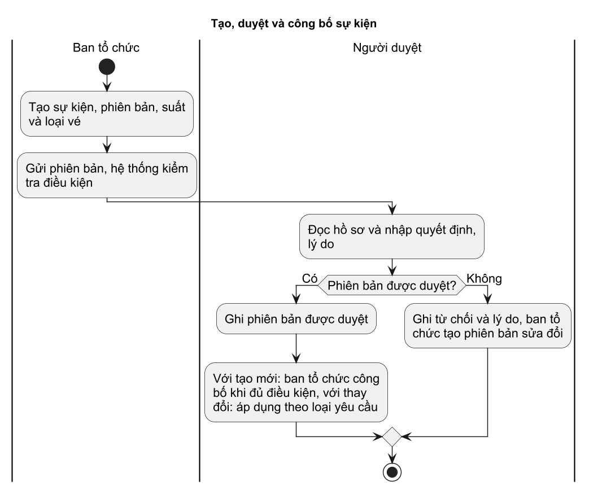

Luồng: ban tổ chức tạo nháp, suất và loại vé rồi gửi phiên bản. Người có quyền xem xét và ghi quyết định. Từ chối trả về lý do để chỉnh sửa bằng phiên bản phù hợp. Duyệt tạo mới cho phép bước công bố riêng; thay đổi, hoãn và hủy thực hiện theo loại yêu cầu và điều kiện của phiên bản. Không đánh đồng trạng thái được duyệt với sự kiện đã công khai.

#### e. Thuê địa điểm và đặt cọc

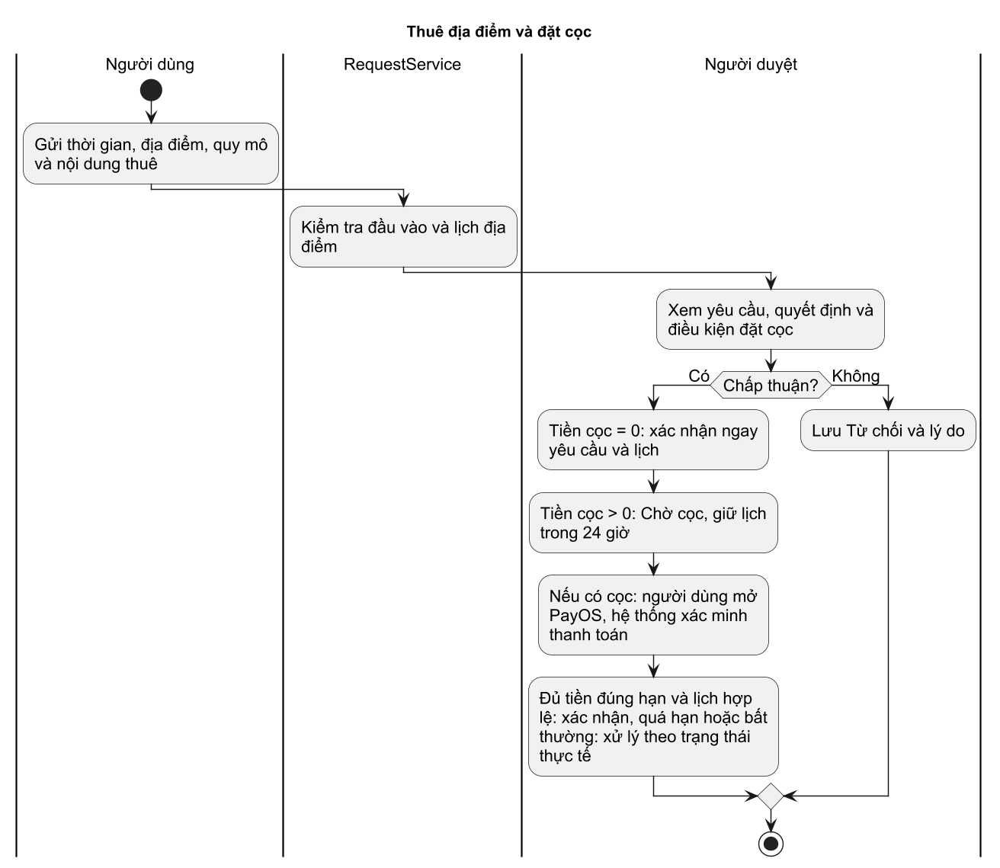

Luồng: người dùng gửi yêu cầu, hệ thống kiểm tra lịch và dữ liệu. Người duyệt chấp thuận hoặc từ chối. Yêu cầu được chấp thuận và có tiền cọc bằng 0 được xác nhận ngay cùng lịch. Nếu tiền cọc lớn hơn 0, yêu cầu chuyển sang Chờ cọc và giữ lịch trong 24 giờ. Người dùng thanh toán qua PayOS; QLSK đối chiếu tiền và điều kiện lịch trước khi xác nhận. Chưa thanh toán, hết hạn hoặc khoản thu bất thường không được coi là lịch đã xác nhận.

#### f. Check-in

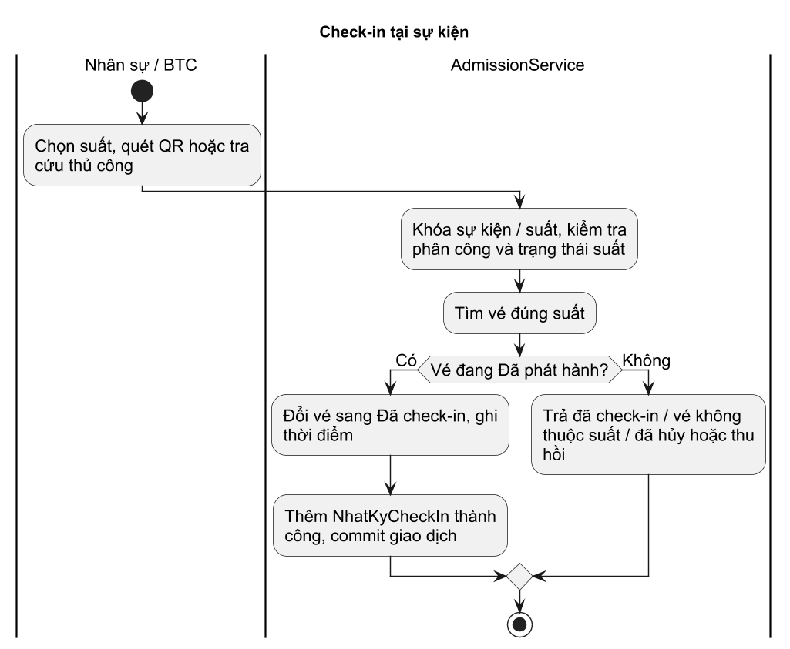

Luồng: chọn suất và quét QR hoặc tra cứu thủ công. Dịch vụ kiểm tra quyền đúng phương thức, trạng thái sự kiện/suất và vé trong giao dịch có khóa. Vé đã phát hành được đổi sang Đã check-in, ghi thời điểm và nhật ký thành công. Vé đã dùng trả thông tin lần trước; vé sai suất, bị hủy hoặc thu hồi bị từ chối. Mã nguồn chỉ thêm NhatKyCheckIn cho nhánh thành công, không khẳng định mọi lần quét thất bại đều được ghi vào bảng này.

#### g. Yêu cầu và duyệt hoàn tiền

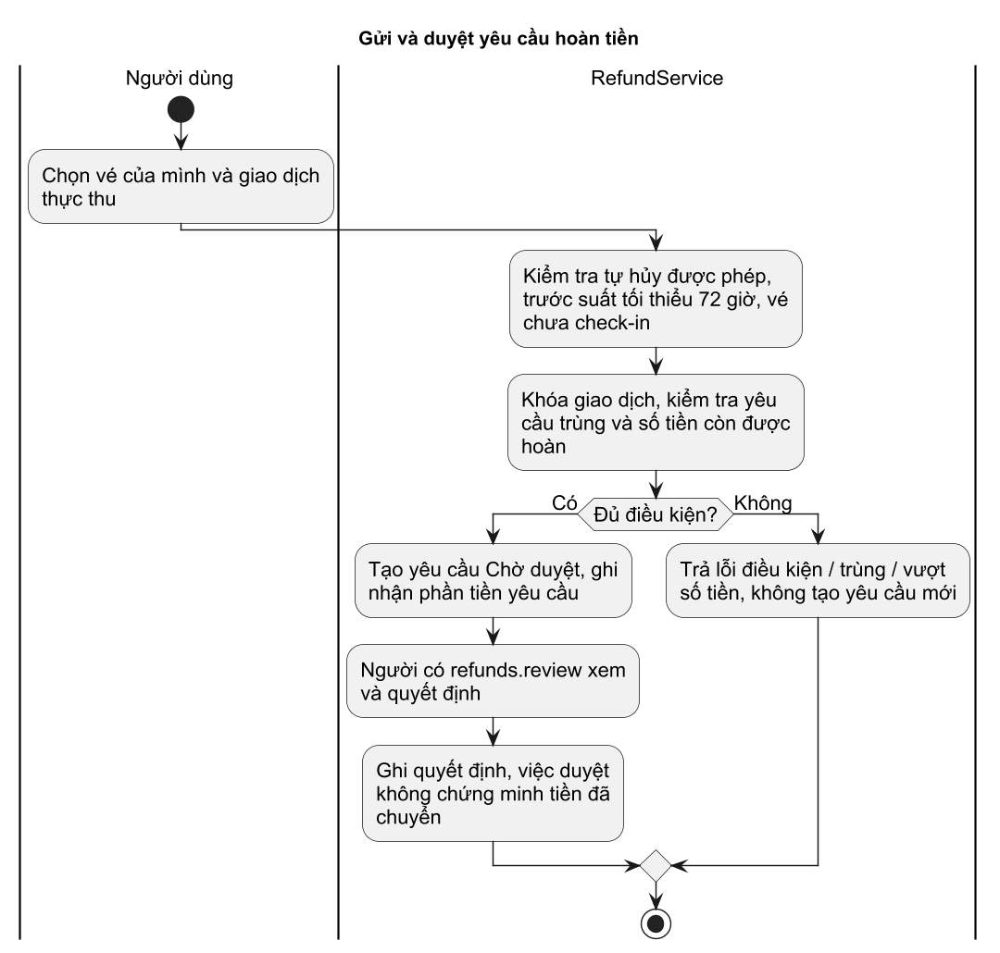

Luồng: người dùng chọn vé thuộc khoản thực thu, dịch vụ kiểm tra cho tự hủy, mốc 72 giờ, trạng thái vé và phần tiền có thể hoàn. Khóa giao dịch bảo vệ chống yêu cầu trùng/vượt mức. Đủ điều kiện thì tạo Chờ duyệt để người có refunds.review quyết định. Trạng thái yêu cầu và trạng thái chuyển tiền phải đọc riêng; quy trình không mô tả một kết nối giải ngân tự động chưa được chứng minh từ mã nguồn.

### 2.3.5 Biểu đồ lớp và ánh xạ MVC

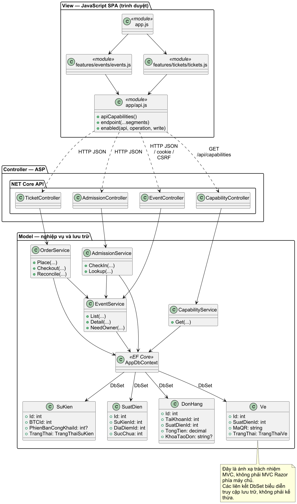

Trong Hình 2.3.17, ký hiệu module dành cho tệp JavaScript, không khẳng định chúng là lớp ES6. Controller nhận yêu cầu HTTP và chuyển actor từ phiên vào dịch vụ. Dịch vụ thực thi quyền, trạng thái và giao dịch; AppDbContext cung cấp DbSet cho EF Core. API phía giao diện dùng cookie cùng nguồn, capabilities và X-CSRF-Token cho thao tác ghi. JSON DTO là hợp đồng truyền dữ liệu giữa hai phía.

| Trách nhiệm | Thành phần thực tế | Vai trò |
|---|---|---|
| View / điều phối giao diện | wwwroot/app/app.js, wwwroot/features/events/events.js, wwwroot/features/tickets/tickets.js | Điều hướng, biểu mẫu, hiển thị dữ liệu và lỗi |
| Kết nối API của View | wwwroot/app/api.js | fetch JSON, cookie, capabilities, CSRF và tải tệp |
| Controller | EventController, TicketController, AdmissionController, CapabilityController | Route, binding, actor và kiểu phản hồi HTTP |
| Model nghiệp vụ | EventService, OrderService, AdmissionService, CapabilityService | Quyền sở hữu, giữ ghế, trạng thái, check-in, danh sách thao tác được phép |
| Model dữ liệu | Domain/Entities và Domain/Enums | Thực thể, khóa, trạng thái miền nghiệp vụ |
| Lưu trữ | Data/AppDbContext.cs và Data/Configs | Ánh xạ EF Core, khóa ngoại và chỉ mục SQL Server |

Căn cứ: [EventController](../../Features/Events/EventController.cs), [TicketController](../../Features/Tickets/TicketController.cs), [AdmissionController](../../Features/Admissions/AdmissionController.cs), [AppDbContext](../../Data/AppDbContext.cs).

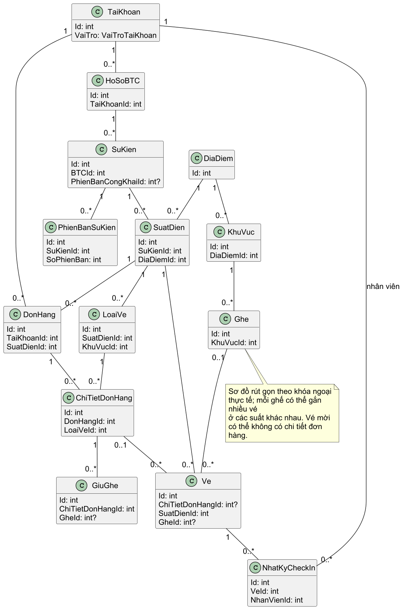

Hình 2.3.18 thể hiện các quan hệ tài khoản–tổ chức–sự kiện–suất–đơn–vé, cùng địa điểm, khu vực và ghế. Bội số là quan hệ theo khóa ngoại và khả năng có bản ghi, không ép sự kiện nháp phải có ngay một suất hoặc đơn phải có dữ liệu hoàn chỉnh trong mọi thời điểm kỹ thuật. Ve.ChiTietDonHangId có thể rỗng đối với vé mời; một ghế có thể xuất hiện trên các vé của nhiều suất khác nhau. PhienBanCongKhaiId chọn phiên bản công khai trong cơ chế phiên bản; sơ đồ rút gọn không vẽ tất cả quan hệ phụ để giữ độ rõ.

Căn cứ: [thực thể sự kiện](../../Domain/Entities/NhomSuKien.cs), [thực thể đặt vé](../../Domain/Entities/NhomDatVe.cs), [thực thể tổ chức](../../Domain/Entities/NhomTaiKhoan.cs), [cấu hình dữ liệu](../../Data/Configs/).
