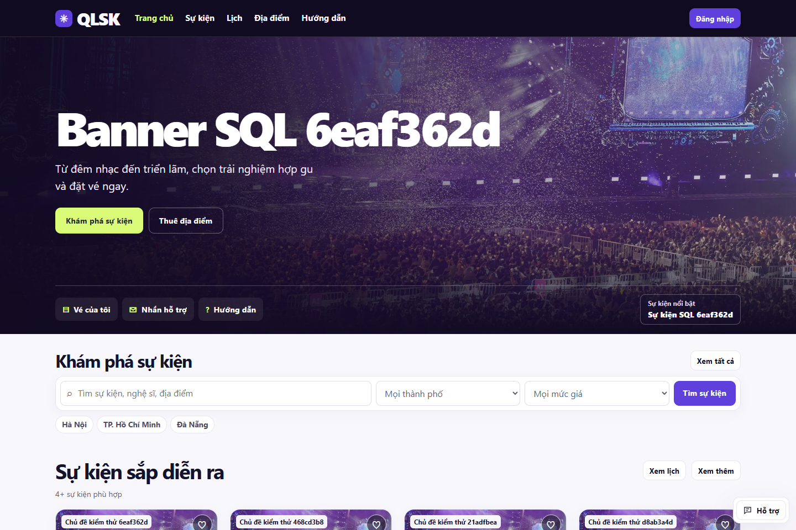
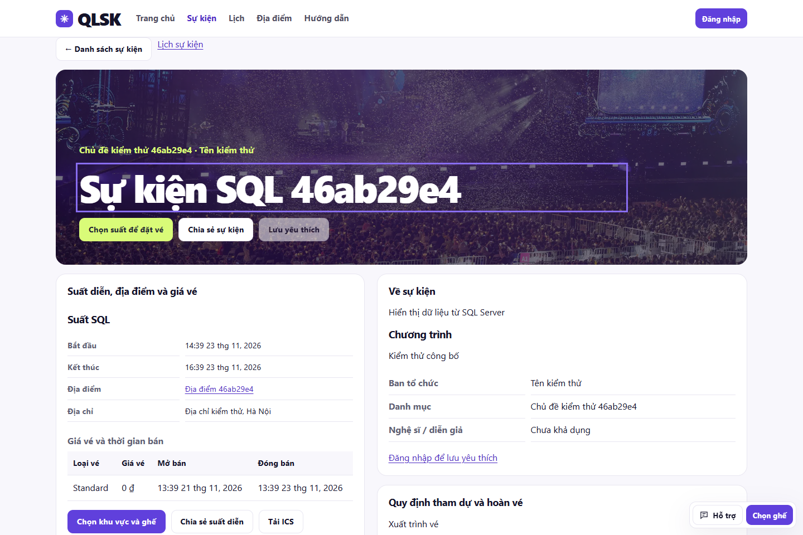
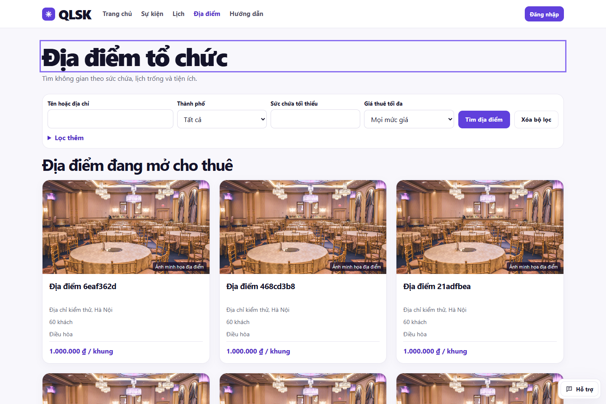
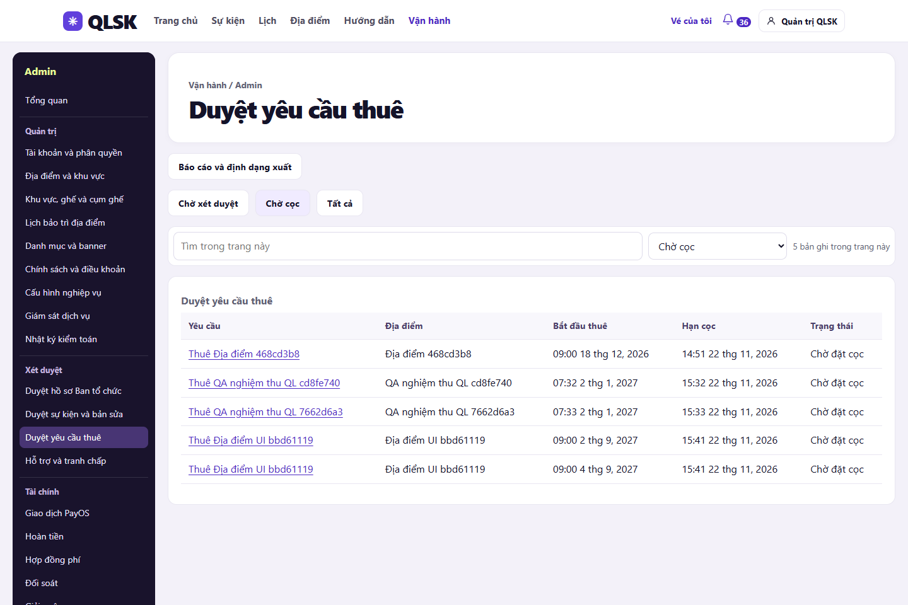
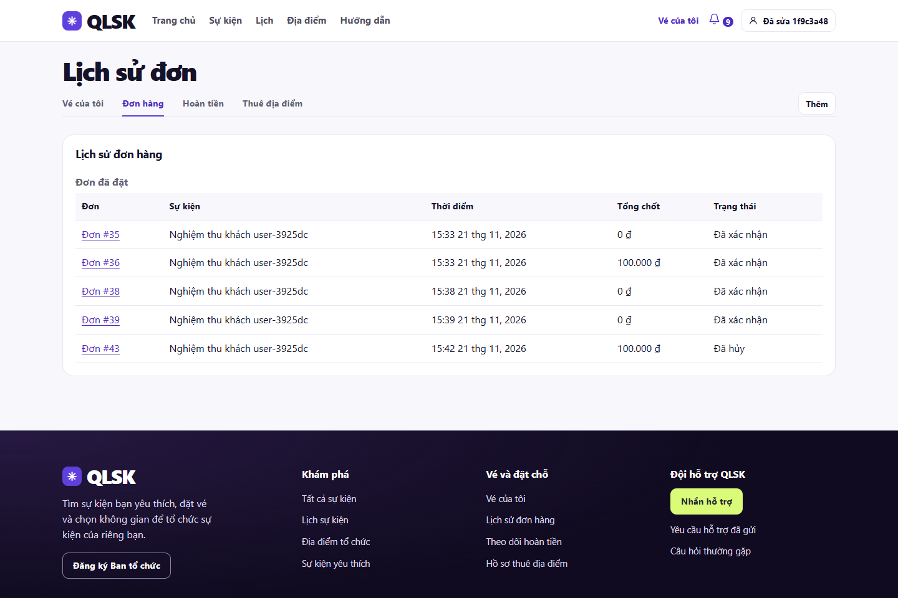
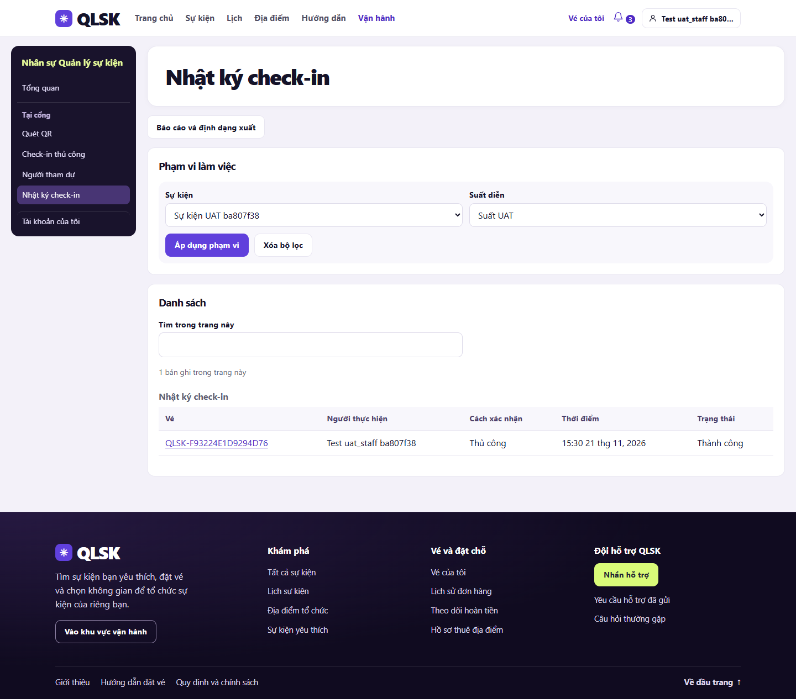
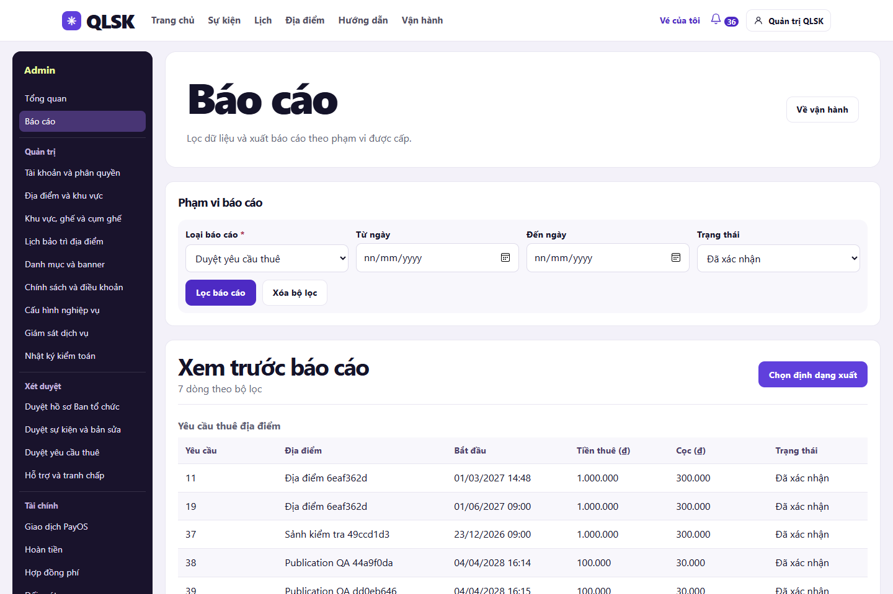

# Chương 4. Kết quả và hướng phát triển

## 4.1. Kết quả thực hiện

### 4.1.1. Khách tra cứu và chọn suất

Ảnh dưới được chụp trực tiếp trên Microsoft Edge từ ứng dụng QLSK đang chạy với dữ liệu QA lúc 18 giờ 46 ngày 21/11/2026. Tên banner và sự kiện có chữ “SQL” là tên bản ghi của bộ kiểm thử. Khung giao diện có kích thước 1440 × 960 px. Có thể mở bản chụp toàn trang để xem phần lịch dài bên dưới. [Nhật ký chụp](bang-chung/captures.json) · [Ảnh chi tiết toàn trang](anh/chi-tiet-su-kien.png)

Từ danh sách sự kiện, người mua mở chi tiết trước khi chọn suất. Trong ca lọc giá được chạy lại khi lập báo cáo, cả ba kết quả trả về đều có giá thấp nhất 100.000 đồng. Một ca độc lập đối chiếu mã suất giữa trang chi tiết và lịch theo thời gian. Các phép kiểm tra này xác nhận dữ liệu mà giao diện dùng để dẫn người mua đến đúng suất. [Kết quả API mới](bang-chung/public-smoke.json)

### 4.1.2. Thuê địa điểm và xử lý hồ sơ

Khi khách mở địa điểm, trang chi tiết cho xem khung bận trước khi lập yêu cầu thuê. Trong biên bản thao tác đã lưu, người thử chọn ngày 23/11/2026 ở địa điểm số 6 và thấy khung bận từ 14 giờ 25 đến 16 giờ 25. Ở phía quản lý, lọc trạng thái chờ cọc trả về năm hồ sơ. Hai màn hình phục vụ hai quyết định khác nhau là chọn giờ gửi yêu cầu và theo dõi hồ sơ đã được duyệt giữ lịch. [Biên bản giao diện](../testcases/04-kiem-ke-trang-giao-dien.md)

### 4.1.3. Vé, vào cổng và báo cáo

Ảnh lịch sử đơn cho thấy người mua có thể đối chiếu mã đơn, thời gian, số tiền và trạng thái. Trong bộ ca đã lưu, đơn số 36 có tổng 100.000 đồng và đã xác nhận. Đối với người đứng cổng, kết quả cần xem là mã vé đã dùng, giờ vào và cách xác nhận. Ở tài khoản vận hành, bảng nhật ký ghi nhận được sự kiện đó theo suất. [Kiểm kê trang Vé và đơn hàng](../testcases/04-kiem-ke-trang-giao-dien.md) · [Biên bản BTC và nhân viên](../testcases/02-ban-to-chuc-nhan-vien.md)

Trong báo cáo thuê, bộ lọc “Đã xác nhận” cho bảy dòng xem trước. Tệp Excel của cùng lượt thử có bảy dòng dữ liệu và một dòng tiêu đề. Kết quả đó kiểm tra được việc giữ bộ lọc từ màn hình sang tệp tải về. [Biên bản xuất tệp](../testcases/04-kiem-ke-trang-giao-dien.md)

### 4.1.4. Mức độ hoàn thành có thể kiểm chứng

| Đối tượng | Kết quả | Phạm vi kết luận |
|---|---|---|
| Cơ sở dữ liệu demo | Nạp mới 37 bảng với tổng 694 dòng. Chạy lại cho cùng số dòng ở từng bảng. | Đã chạy trực tiếp trên LocalDB riêng trong đợt lập báo cáo. [Kết quả nạp demo](bang-chung/isolated-demo-seed.json) |
| Truy cập công khai | 10/10 ca API bổ sung đạt trên bản QA đang chạy. | Gồm tìm, lọc, chi tiết, lịch, địa điểm và chính sách. [Biên bản chạy](bang-chung/public-smoke.json) |
| Nghiệp vụ theo vai trò | Bộ nghiệm thu dự án ghi nhận 81/81 ca giao diện đạt và có hồ sơ kiểm thử dữ liệu demo theo vai trò. | Đây là kết quả các đợt đã lưu; xem mô tả giới hạn từng nhóm ở mục 3.3. [Biên bản nghiệm thu](../testcases/README.md) |
| Biên dịch | Mã nguồn hiện tại biên dịch thành công. Công cụ trả hai cảnh báo NuGet về một phụ thuộc. | Cần đánh giá phiên bản phụ thuộc khi chuẩn bị phát hành. [Kết quả biên dịch và kiểm thử](kiem-thu.md) |
| Tích hợp bên ngoài | Có mã xử lý payOS và thư SMTP. | Các khoản thu/thanh toán trong seed là dữ liệu mô phỏng. Chuyển tiền thực, chuyển hoàn và phát thư ra hộp thư người nhận vẫn cần nghiệm thu theo môi trường đích. |

## 4.2. Hướng phát triển

| Ưu tiên | Khoảng trống hiện tại | Hạng mục tiếp theo và tiêu chí hoàn thành |
|---|---|---|
| 1. Khoản thu, hoàn và giải ngân | Hồ sơ giữ được bằng chứng thu và quyết định duyệt. Việc chuyển tiền cho khách hoặc BTC cần chứng từ của kênh chi. | Nghiệm thu một đơn và một cọc trên tài khoản triển khai; nối lệnh chi có mã tham chiếu, lưu chứng từ, kiểm tra gửi lại và đối chiếu từng khoản giữa QLSK với kênh thanh toán. |
| 2. Thay đổi khi sự kiện đã bán vé | Hoãn/hủy sự kiện có vé hoặc tiền liên quan cần xử lý ảnh hưởng tới người mua trước khi khép lại hồ sơ. | Tạo danh sách vé bị tác động, xác định quyền đổi/hoàn, theo dõi thông báo và công nợ. Nghiệm thu một suất có nhiều đơn, trong đó có vé đã giảm giá. |
| 3. Quản lý khuyến mãi và vé mời | Backend hỗ trợ xét mã khi đặt đơn. Controller quản lý voucher hiện có thao tác danh sách và chi tiết. PDF vé hiện tập trung vào mã QR. | Bổ sung tạo/sửa/ngừng chiến dịch với điều kiện hiệu lực và lịch sử. Thử gửi vé mời trên kênh thật và bổ sung tên sự kiện, suất, ghế trên PDF để dùng khi đối chiếu tại cổng. |
| 4. Vận hành dữ liệu lớn | Bộ bằng chứng hiện có chủ yếu trên QA và seed. Chưa có số đo phục vụ cam kết tải tại giờ mở bán. | Đo thời gian đáp ứng khi nhiều khách cùng đặt một suất, thời gian giải phóng giữ chỗ và xuất báo cáo nhiều kỳ. Dùng số liệu để chọn chỉ mục và lập ngưỡng nghiệm thu. |
| 5. Quản trị vòng đời dữ liệu | Giấy tờ BTC được lưu riêng và mã hóa; khả năng đọc lại còn phụ thuộc kho khóa. | Xây dựng quy trình lưu giữ/xóa hồ sơ, sao lưu SQL và kho khóa, diễn tập khôi phục rồi thử mở giấy tờ và đối chiếu một đơn cũ. |

[Điểm còn mở theo phân hệ](../frontend-standardization/06_GAP_ANALYSIS.md) · [Phạm vi nghiệm thu từng chức năng](../testcases/README.md) · [Controller voucher](../../Features/Tickets/VoucherController.cs)
