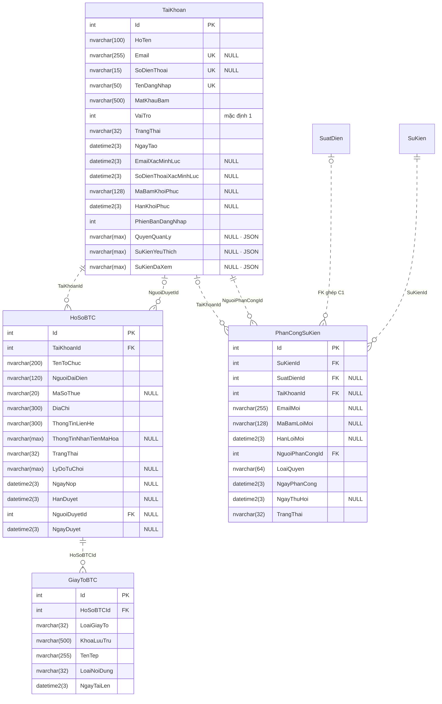
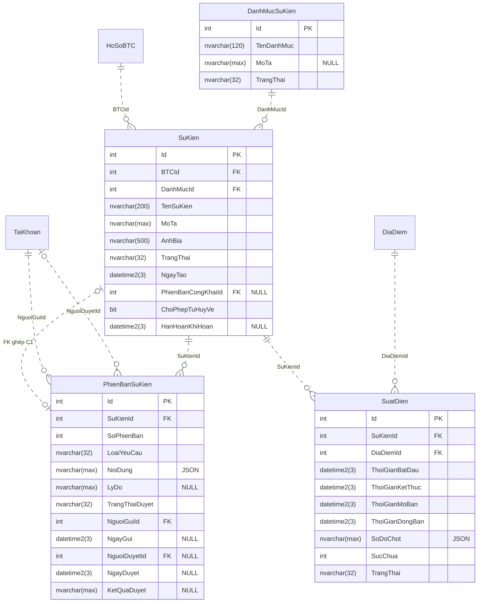
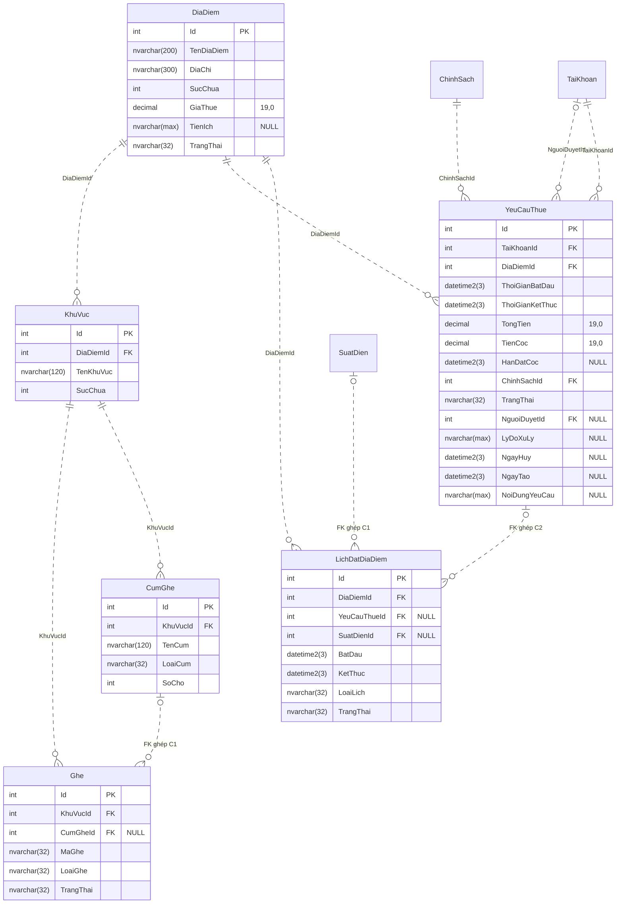
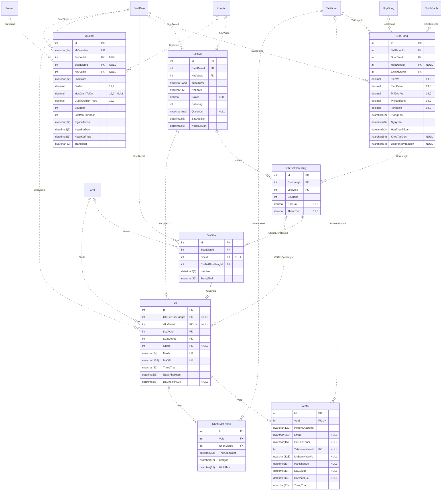
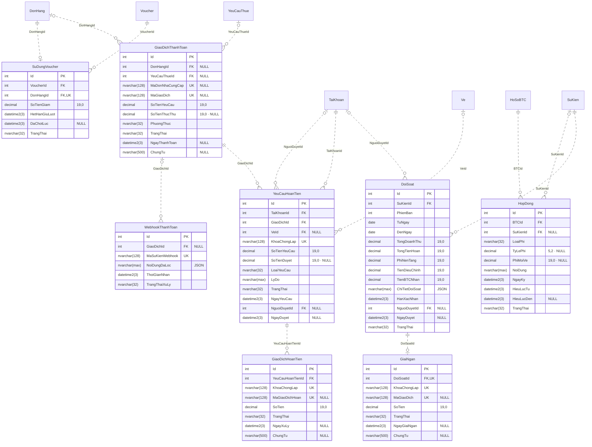
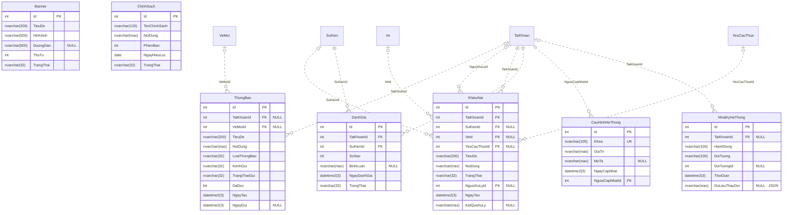

# Physical ERD hệ thống quản lý và tổ chức sự kiện

Sáu sơ đồ thể hiện **37 bảng** và **75 khóa ngoại** theo mô hình EF Core. Bảng được khai báo đủ cột trong nhóm của nó. Để đọc trên giấy A4, mở [sơ đồ theo luồng nghiệp vụ](bao-cao/erd/README.md) hoặc [bản tra cứu từng bảng và khóa ngoại](bao-cao/erd/Tra-cuu-37-bang.pdf).

[Ảnh PNG ERD tổng thể](anh_erd/07-erd-tong-the-37-bang.png) trình bày đủ 37 bảng và 75 khóa ngoại trên cùng một sơ đồ, kích thước **11.124 × 6.263 px**. Màu tiêu đề bảng cho biết phân hệ.

Sáu ảnh theo phân hệ cùng kích thước **5.200 × 5.440 px**.

| Nhóm | Số bảng | Ảnh |
|---|---:|---|
| [Tài khoản và phân quyền](#1-tài-khoản-và-phân-quyền) | 4 | [PNG](anh_erd/01-tai-khoan-va-phan-quyen.png) |
| [Quản lý sự kiện](#2-quản-lý-sự-kiện) | 4 | [PNG](anh_erd/02-quan-ly-su-kien.png) |
| [Địa điểm và ghế](#3-địa-điểm-và-ghế) | 6 | [PNG](anh_erd/03-dia-diem-va-ghe.png) |
| [Đặt vé và check-in](#4-đặt-vé-và-check-in) | 8 | [PNG](anh_erd/04-dat-ve-va-check-in.png) |
| [Thanh toán và tài chính](#5-thanh-toán-và-tài-chính) | 8 | [PNG](anh_erd/05-thanh-toan-va-tai-chinh.png) |
| [Quản trị và hỗ trợ](#6-quản-trị-và-hỗ-trợ) | 7 | [PNG](anh_erd/06-quan-tri-va-ho-tro.png) |

Mỗi ảnh PNG có chú giải và đường nối vuông góc. Ảnh 04, 05 và 06 có các khung theo luồng nghiệp vụ. Ô **Tham chiếu** chỉ đến bảng được trình bày đầy đủ ở khung hoặc phân hệ khác.

| Ký hiệu | Ý nghĩa |
|---|---|
| Hai vạch | Đúng một (1..1) |
| Vòng tròn và vạch | Không hoặc một (0..1) |
| Vạch và chân quạ | Một hoặc nhiều (1..N) |
| Vòng tròn và chân quạ | Không hoặc nhiều (0..N) |
| Nét liền | Quan hệ định danh. Khóa ngoại tham gia xác định khóa chính của bản ghi con. |
| Nét đứt | Quan hệ không định danh. Bản ghi con có khóa chính độc lập. |
| `PK`, `FK`, `UK` | Khóa chính, khóa ngoại, cột duy nhất. |
| `NULL`, `—` | Cột cho phép NULL hoặc bắt buộc có giá trị. |
| `FK ghép C1`, `FK ghép C2` | Khóa ngoại ghép, đánh số trong từng bảng con. Cặp danh sách cột có thứ tự nằm ở phần ràng buộc của bảng. |
| `UQ`, `UX`, `UXF` | Ràng buộc SQL `UNIQUE`, chỉ mục duy nhất, chỉ mục duy nhất có lọc. |
| `JSON` | Cột `nvarchar(max)` lưu JSON. Kiểm tra `ISJSON` áp dụng với các cột có ràng buộc tương ứng. |

## 1. Tài khoản và phân quyền

`TaiKhoan.VaiTro` mặc định `1`. `PhanCongSuKien` có hai chỉ mục duy nhất có lọc cho quyền đang hiệu lực, theo toàn sự kiện hoặc theo từng suất.

`TaiKhoan.SuKienYeuThich` và `TaiKhoan.SuKienDaXem` là mảng ID lưu bằng JSON. Lịch sử xem giữ tối đa 20 sự kiện theo thứ tự xem gần nhất. API đọc danh sách theo tài khoản đăng nhập và chỉ trả sự kiện còn công khai.

`PhanCongSuKien.C1`: `(SuatDienId, SuKienId)` → `SuatDien(Id, SuKienId)`. Cặp đích là ràng buộc `UQ`.

## 2. Quản lý sự kiện

`SuKien` sở hữu nhiều phiên bản qua `PhienBanSuKien.SuKienId`. `SuKien.Id` là PK độc lập và cũng xuất hiện trong danh sách cột của ràng buộc tham chiếu phiên bản.

`SuKien.C1`: `(PhienBanCongKhaiId, Id)` → `PhienBanSuKien(Id, SuKienId)`. Cặp đích là `UQ`, giới hạn phiên bản công khai trong cùng sự kiện.

Khi duyệt lần đầu, `SuKien.TrangThai = DaDuyet` và `PhienBanCongKhaiId` vẫn là `NULL`. BTC xem trước nội dung, suất và `LoaiVe.GiaVe` rồi bấm **Công khai** để gán phiên bản công khai. Mở lại bản nháp giữ các suất và giá vé, đồng thời yêu cầu duyệt lại.

`SuatDien.SoDoChot` lưu thêm khóa JSON `rentalId` khi BTC gắn hồ sơ thuê. Ứng dụng kiểm tra ID trỏ đến `YeuCauThue` đã xác nhận của BTC, đúng địa điểm và phủ đủ giờ diễn. Liên kết trong JSON do ứng dụng kiểm tra. Các khóa ngoại vật lý của lịch nằm ở `LichDatDiaDiem`.

## 3. Địa điểm và ghế

Khóa ghép của `Ghe` bảo đảm ghế thuộc cùng khu vực với cụm. Hai khóa ghép của `LichDatDiaDiem` bảo đảm lịch cùng địa điểm với yêu cầu thuê hoặc suất diễn được liên kết.

| FK ghép | Cột tham chiếu | Cặp cột đích có `UQ` |
|---|---|---|
| `Ghe.C1` | `(CumGheId, KhuVucId)` | `CumGhe(Id, KhuVucId)` |
| `LichDatDiaDiem.C1` | `(SuatDienId, DiaDiemId)` | `SuatDien(Id, DiaDiemId)` |
| `LichDatDiaDiem.C2` | `(YeuCauThueId, DiaDiemId)` | `YeuCauThue(Id, DiaDiemId)` |

## 4. Đặt vé và check-in

Các chỉ mục có lọc giới hạn mỗi ghế đang giữ và mỗi ghế đã cấp còn hiệu lực theo suất. `NhatKyCheckIn` lưu nhiều lần quét, với tối đa một lần thành công trên mỗi vé.

`Ve.C1`: `(LoaiVeId, SuatDienId)` → `LoaiVe(Id, SuatDienId)`. Cặp đích là ràng buộc `UQ`.

## 5. Thanh toán và tài chính

`GiaoDichThanhToan` gắn đúng một trong `DonHang` và `YeuCauThue`. Mỗi bên có thể có nhiều lần thử, với tối đa một giao dịch thành công. Mỗi bản `DoiSoat` có tối đa một `GiaiNgan`.

## 6. Quản trị và hỗ trợ

`ThongBao` có đúng một đích nhận qua `TaiKhoan` hoặc `VeMoi`. `DanhGia` duy nhất theo cặp tài khoản và sự kiện. `NhatKyHeThong.DoiTuongId` là mã đối tượng ghi nhật ký.
