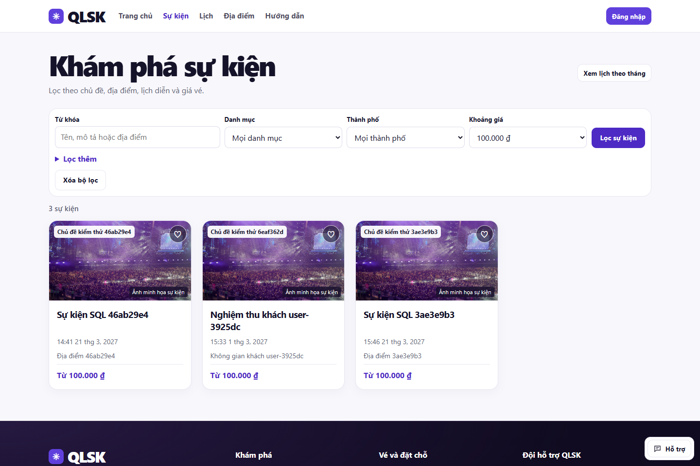
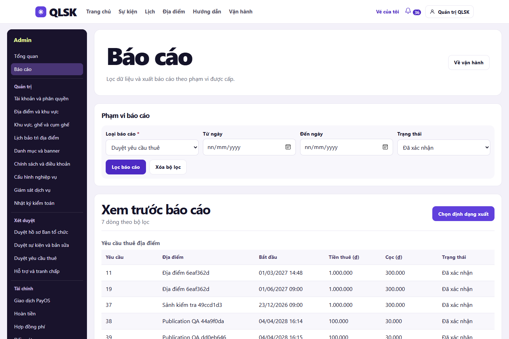

# Kiểm kê trang giao diện chính thức QLSK

**QLSK có 13 trang chính trong `wwwroot`** khi đếm theo các đường dẫn cấp đầu mà bộ định tuyến đăng ký. Ngày 21/11/2026, cả 13 trang đều mở được và thực hiện được thao tác ghi dưới đây trên Microsoft Edge. Bộ bằng chứng gồm 18 ảnh chụp mới ở kích thước 1440 × 960 px.

## Cách đếm

| Đối tượng | Số lượng | Phạm vi |
|---|---:|---|
| Trang chính | **13** | Mỗi tên trong bảng `renders` tính một lần. Ví dụ, danh sách `#events` và chi tiết `#event/{id}` là hai trang. Các sự kiện khác ID cùng dùng trang chi tiết. |
| Tệp HTML thuộc giao diện chính thức | **15** | Một khung ứng dụng `index.html` và 14 mẫu trong `features/`. Trong đó, 13 mẫu tương ứng với 13 trang chính. Mẫu bổ sung `work-overview.html` được nạp bên trong trang Vận hành. |
| Tổng tệp HTML trong `wwwroot` | **16** | Gồm 15 tệp trên và một giao diện mẫu VÉNUE tại `giaodientest/giaodienmau.html`. |

Các tab, bộ lọc, hộp thoại và mục nghiệp vụ nằm dưới trang chính tương ứng. Ví dụ, Vé của tôi và Lịch sử đơn cùng thuộc `#tickets`. Riêng `#work` có tổng quan và 30 mục nghiệp vụ được khai báo trong 5 nhóm. Quyền của tài khoản quyết định những mục xuất hiện trong menu. [Bộ định tuyến](../../wwwroot/app/app.js) · [Bộ nạp mẫu HTML](../../wwwroot/shared/ui/templates.js) · [Nơi nạp tổng quan vận hành](../../wwwroot/features/work/work.js) · [30 mục nghiệp vụ](../../wwwroot/features/work/work-sections.js)

## Thao tác trên 13 trang

Quá trình chạy thử dùng dữ liệu và tài khoản QA tại `127.0.0.1:5834`. Toàn bộ 64 tệp phục vụ giao diện chính thức trên máy chủ này đã được đối chiếu từng byte với bản `wwwroot` trong dự án. Các số lượng, mã hồ sơ và trạng thái trong bảng là kết quả quan sát tại thời điểm thử.

### Khách truy cập

| Trang | Đường dẫn chính | Thao tác và kết quả | Ảnh chụp |
|---|---|---|---|
| 01. Trang chủ | `#home` | Bấm **Khám phá sự kiện**, chọn **Miễn phí** rồi bấm **Tìm sự kiện**. Mục Sự kiện sắp diễn ra hiển thị “4+ sự kiện phù hợp”. | [Trang chủ](evidence/trang-chinh-thuc/01a-trang-chu.png) · [Sau khi lọc](evidence/trang-chinh-thuc/01b-loc-trang-chu.png) |
| 02. Danh sách sự kiện | `#events` | Chọn khoảng giá **100.000 ₫** rồi bấm **Lọc sự kiện**. Danh sách còn 3 sự kiện, cả 3 thẻ đều ghi “Từ 100.000 ₫”. | [Kết quả lọc](evidence/trang-chinh-thuc/02-danh-sach-su-kien.png) |
| 03. Chi tiết sự kiện | `#event/{id}` | Mở sự kiện đầu tiên trong kết quả lọc (`#event/9`), tìm suất có vé **100.000 ₫** và bấm **Tải ICS**. Tệp `qlsk-suat-dien.ics` tải về có tên sự kiện và thời điểm bắt đầu. | [Chi tiết sự kiện](evidence/trang-chinh-thuc/03a-chi-tiet-su-kien.png) · [Suất đã chọn để tải lịch](evidence/trang-chinh-thuc/03b-suat-dien.png) |
| 04. Lịch sự kiện | `#calendar` | Bấm ngày **23/11/2026** trên lịch tháng. Ô ngày được chọn và danh sách bên cạnh hiển thị **13 suất diễn** của ngày đó. | [Lịch theo ngày](evidence/trang-chinh-thuc/04-lich.png) |
| 05. Danh sách địa điểm | `#venues` | Chọn **Hà Nội**, đặt giá thuê tối đa **1.000.000 ₫** rồi bấm **Tìm địa điểm**. Kết quả đầu tiên là địa điểm QA có sức chứa 60 khách, giá 1.000.000 ₫/khung. | [Bộ lọc và kết quả](evidence/trang-chinh-thuc/05-danh-sach-dia-diem.png) |
| 06. Chi tiết địa điểm | `#venue/{id}` | Mở địa điểm đầu tiên (`#venue/6`) rồi chọn **23/11/2026**. Bảng lịch ghi một khung **Bận**, từ **14:25 đến 16:25**. | [Chi tiết địa điểm](evidence/trang-chinh-thuc/06a-chi-tiet-dia-diem.png) · [Khung giờ đã bận](evidence/trang-chinh-thuc/06b-lich-dia-diem.png) |
| 07. Hướng dẫn | `#guide` | Chọn **Câu hỏi thường gặp**, mở “Tôi có bao lâu để thanh toán vé?”. Câu trả lời ghi thời gian giữ ghế là **10 phút** và có liên kết mở lịch sử đơn. | [Câu trả lời đang mở](evidence/trang-chinh-thuc/07-huong-dan.png) |

### Người dùng và ban tổ chức

| Trang | Đường dẫn chính | Thao tác và kết quả | Ảnh chụp |
|---|---|---|---|
| 08. Tài khoản | `#account` | Đăng nhập bằng tài khoản người dùng QA, bấm chuông thông báo. Hộp thông báo hiển thị 10 dòng, có cả mục đã đọc và mục có thể đánh dấu đã đọc. | [Hộp thông báo](evidence/trang-chinh-thuc/08-tai-khoan.png) |
| 09. Vé và đơn hàng | `#tickets` | Từ **Vé của tôi**, chọn **Đơn hàng**. Lịch sử hiển thị 5 đơn, trong đó đơn **#36** có tổng 100.000 ₫ và trạng thái **Đã xác nhận**. | [Lịch sử đơn](evidence/trang-chinh-thuc/09-ve-va-don-hang.png) |
| 10. Yêu cầu thuê, hoàn tiền và hỗ trợ | `#requests` | Từ menu tài khoản, chọn **Yêu cầu hỗ trợ** rồi mở yêu cầu **#12**. Trang chi tiết hiển thị phản hồi, tiến trình và trạng thái **Đã giải quyết**. | [Chi tiết yêu cầu hỗ trợ](evidence/trang-chinh-thuc/10-yeu-cau.png) |
| 11. Hồ sơ ban tổ chức | `#organizer` | Đăng nhập bằng tài khoản BTC, mở **Trạng thái và lịch sử** rồi chọn hồ sơ **#13**. Lịch sử có hai bước **Nộp hồ sơ** và **Đã duyệt**, kèm lý do “Hồ sơ UAT hợp lệ”. | [Lịch sử xét duyệt](evidence/trang-chinh-thuc/11-ban-to-chuc.png) |

### Quản trị viên

| Trang | Đường dẫn chính | Thao tác và kết quả | Ảnh chụp |
|---|---|---|---|
| 12. Vận hành | `#work` | Đăng nhập quản trị, bấm **Vận hành**. Tổng quan hiển thị **17 yêu cầu thuê chờ duyệt**. Mở **Duyệt yêu cầu thuê** rồi chọn **Chờ cọc** để xem 5 bản ghi ở trạng thái **Chờ đặt cọc**. | [Tổng quan](evidence/trang-chinh-thuc/12a-van-hanh.png) · [Danh sách chờ cọc](evidence/trang-chinh-thuc/12b-van-hanh-thue.png) |
| 13. Báo cáo và xuất tệp | `#export` | Từ danh sách thuê, bấm **Báo cáo và định dạng xuất**, lọc **Đã xác nhận**. Xem trước có **7 dòng**. Chọn Excel và xuất tệp. Trang tính tải về có **7 dòng dữ liệu và 1 dòng tiêu đề**. | [Xem trước](evidence/trang-chinh-thuc/13a-bao-cao.png) · [Xuất Excel thành công](evidence/trang-chinh-thuc/13b-tai-excel.png) |

## Ảnh minh họa

**Khách lọc sự kiện theo giá vé 100.000 ₫**

**Quản trị viên xem trước bảy yêu cầu thuê đã xác nhận**

